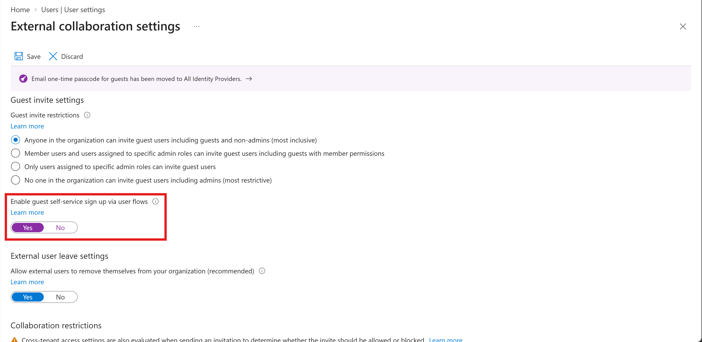
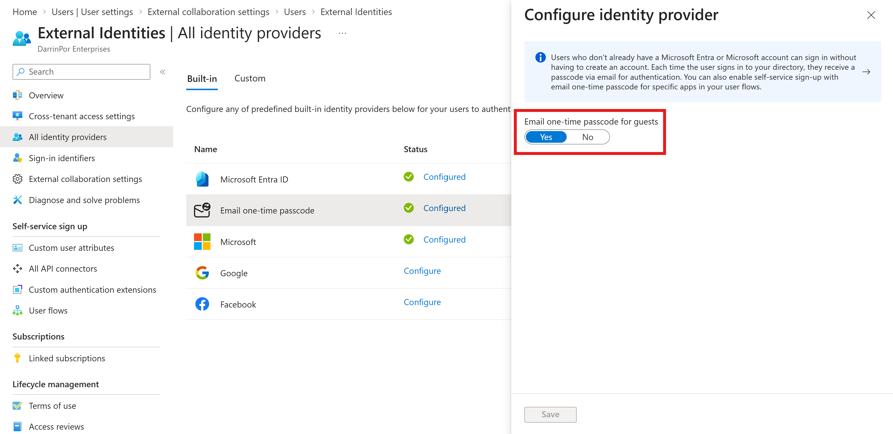
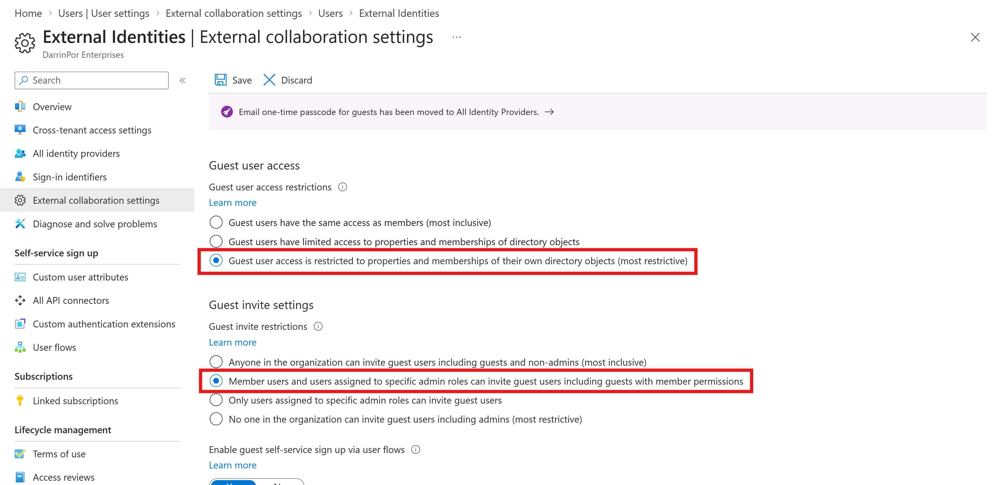

# Lab 04: Configure External Collaboration Settings

## 📋 Lab Objective
Configure tenant-level external collaboration settings within Microsoft Entra ID to govern B2B guest access securely. This lab establishes least-privilege boundary controls, enables secure email one-time passcodes, and provisions guest self-service sign-up workflows aligned with Zero Trust architecture principles.

---

## 🛠️ Implementation Steps & Verification

### Exercise 1: Allowing Guest Users to Be Invited into Your Organization

#### Task 1: Enable Guest Users to Perform Self-Service Sign-Up
1. Signed in to the **Microsoft Entra admin center** (`https://entra.microsoft.com`) as a Global Administrator.
2. Navigated to **Entra ID** → **Users** → **All users** → **User Settings** → **Manage external user collaboration settings**.
3. Configured guest self-service registration workflows to allow streamlined external onboarding.

#### `01-guest-self-service-signup.png`

* **Visual Annotations & Highlights:**
  * **Red Box:** Highlights the **Enable guest self-service sign up via user flows** toggle set to **Yes**.
* **Technical Note:** Tenant-level enablement allowing external guest users to register themselves into user flows without direct administrative provisioning overhead.

---

#### Task 2: Configure External Collaboration Settings & Identity Providers
1. Navigated to **Entra ID** → **External Identities** → **All identity providers**.
2. Selected **Email one-time passcode** and verified its active configuration status.

#### `02-email-otp-provider.png`

* **Visual Annotations & Highlights:**
  * **Red Box:** Highlights **Email one-time passcode for guests** configured to **Yes**.
* **Technical Note:** Email one-time passcodes provide a secure authentication method for guests who do not have a pre-existing Microsoft or organizational account, verifying their email ownership at login.

3. Returned to **External Identities** → **External collaboration settings** to configure guest boundaries.

#### `03-external-collaboration-settings.png`

* **Visual Annotations & Highlights:**
  * **Top Red Box (Guest User Access):** Highlights **Guest user access is restricted to properties and memberships of their own directory objects (most restrictive)**.
  * **Bottom Red Box (Invite Permissions):** Highlights **Member users and users assigned to specific admin roles can invite guest users including guests with member permissions**.
* **Technical Note:** Enforces least-privilege boundary controls. Restricting guest directory visibility prevents external identities from enumerating internal users, groups, or organizational directory resources.

---

## 🔍 Troubleshooting & Environmental Notes
* **Identity Provider Precedence:** Microsoft Entra automatically prioritizes federated identity providers (such as Google or Facebook) and organizational direct federation before falling back to email one-time passcodes.
* **Collaboration Restrictions:** Allow/deny domain lists operate independently from SharePoint Online and OneDrive file-sharing policies; tenant-level B2B restrictions must be coordinated across workloads for comprehensive governance.
