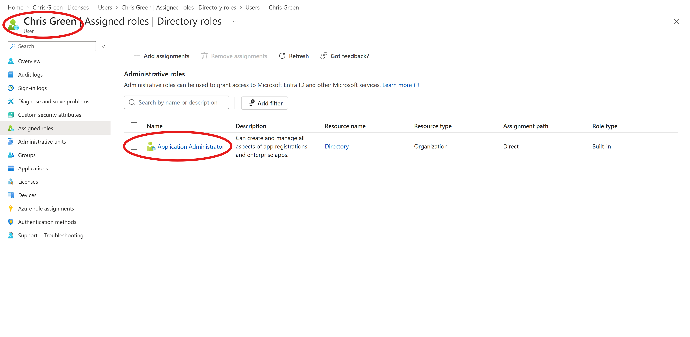
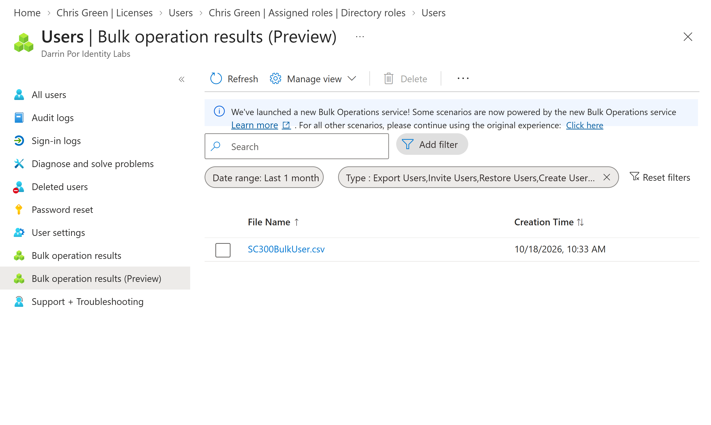
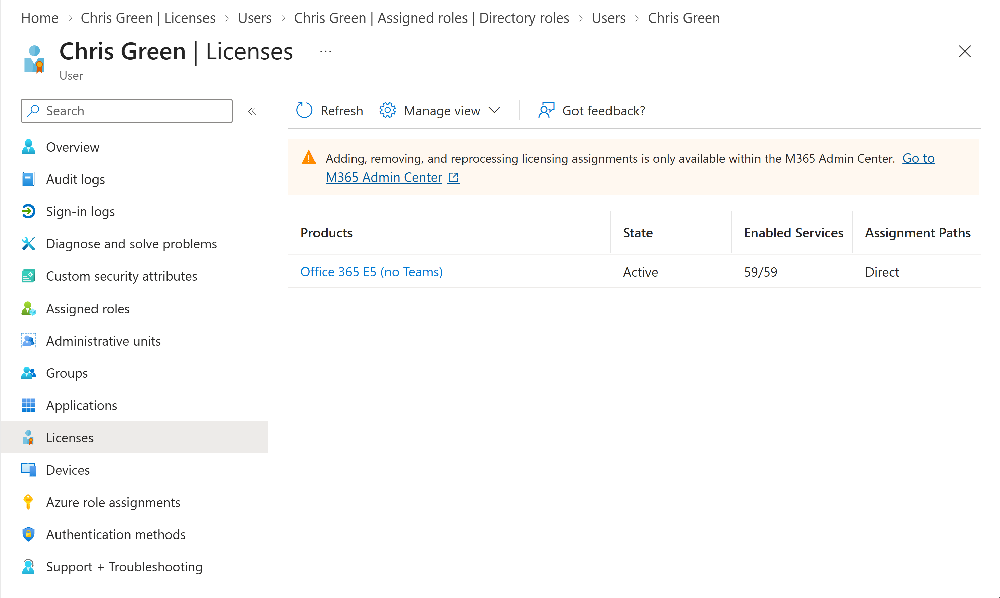

# 🧪 Lab 01: Manage User Roles and Identity Provisioning in Microsoft Entra ID


---


## 1. Executive Summary & Objective


### 🏢 Business Scenario

As I build my foundational skills for an Identity and Access Management (IAM) role, I need to understand how organizations handle day-to-day user lifecycle management. This includes provisioning user accounts, granting scoped administrative access without over-privileging, handling bulk onboarding, recovering deleted accounts, and assigning product licenses.


### 🎯 Objective

Execute core identity and access administration tasks within a Microsoft 365 Developer Tenant using the Microsoft Entra admin center, PowerShell, and CSV templates[cite: 1, 4, 6]. This lab focuses on creating user accounts, testing application administration rights, practicing bulk user provisioning, handling soft-delete recoveries, and assigning product licenses.


**Target Certification Domain:** Domain 1 — Implement an Identity Management Solution (User & Role Management)
**Official Lab Reference:** [Microsoft Learn SC-300 Lab 01](https://microsoftlearning.github.io/SC-300-Identity-and-Access-Administrator/Instructions/Labs/Lab_01_ManageUserRoles.html)
**Tenant Type:** Microsoft 365 Developer Tenant (Entra ID P2)


---


## 2. Architecture & Control Design


```text

[ Admin Portal / PowerShell ] ──► [ User Lifecycle & UPN Creation ] ──► [ Scoped Role Assignment (App Admin) ]

                                            │

                                            ▼

                             [ License & Bulk Provisioning ] ──► [ Audit & Verification ]


```


### ⚙️ Implementation Scope


| Action / Phase | Target Account / Object | Configuration & Purpose |

| --- | --- | --- |

| **User Provisioning** | Chris Green (`ChrisG`) | Created initial test account to evaluate default unprivileged permissions.


 |

| **Role Assignment** | Chris Green | Assigned **Application Administrator**.


 |

| **Bulk Provisioning** | CSV Batch & PowerShell | Automated user creation using `New-MgUser` and CSV import templates.


 |

| **Account Recovery** | Chris Green | Tested soft-delete and restoration workflows.


 |

| **License Assignment** | Chris Green | Assigned a product license via the Microsoft 365 admin center *(modified from original lab instructions using Chris Green instead of Raul Razo)*.


 |


---


## 3. Step-by-Step Implementation Guide


### Phase 1: User Creation & Initial Permission Testing


Logged into the **Microsoft Entra admin center** (`https://entra.microsoft.com`) using my Global Administrator account.


2. Navigated to **Identity** --> **Users** --> **All users** --> **+ New user** --> **Create new user**.


3. Created user `Chris Green` with user principal name `ChrisG`, ensuring the password was auto-generated and saved securely.


4. Signed into a new InPrivate browser window as Chris Green to test default rights. Searching for **Enterprise applications** and attempting to select **+ New application** confirmed that **+ Create your own application** was grayed out, verifying zero standing administrative permissions.


---


### Phase 2: Role Assignment & Scoped Privilege Verification


Returned to the Administrator session, opened Chris Green's user profile, and selected **Assigned roles** --> **+ Add assignments**.


2. Selected the **Application Administrator** role, set the assignment type to **Active**, and saved.


3. Signed back in as Chris Green via InPrivate mode. Navigating to **Enterprise applications** --> **+ New application** confirmed that **+ Create your own application** was now successfully unlocked.


4. Cleaned up by navigating to **Roles and administrators**, locating the **Application administrator** role, and removing Chris Green's assignment to adhere to least privilege.


---


### Phase 3: Bulk Import & PowerShell Provisioning (Encountering Hurdles)


Attempted the bulk user creation workflow via a `.csv` file (`SC300BulkUser.csv`) under **Bulk operations** --> **Bulk create**.


> ⚠️ **My Learning Mistake / Hurdle:** I initially ran into trouble here because I had a typo in my domain name within the CSV file. The file wouldn't process correctly and failed to generate users because the UPN domain didn't match my active lab tenant domain. Once I opened the file in Notepad, corrected the domain name to match my `.onmicrosoft.com` tenant suffix, and re-uploaded it, the bulk job succeeded.

> 

> 


2. Switched to PowerShell to practice automation. I ran into a couple of minor command typos while typing out parameters, which taught me to double-check syntax carefully.

3. Installed and imported the Microsoft Graph module (`Install-Module Microsoft.Graph -Scope CurrentUser`), connected using `Connect-MgGraph -Scopes "User.ReadWrite.All"`, and verified existing users with `Get-MgUser`.


4. Configured a password profile (`$PWProfile`) and successfully provisioned a new test user using the `New-MgUser` cmdlet with specific department and job title attributes.


---


### Phase 4: Account Deletion and Soft-Delete Recovery


Selected Chris Green under **All users** and clicked **Delete** to simulate an accidental account termination.


2. Navigated to **Deleted users** in the left menu, located Chris Green, and selected **Restore user** to verify the 30-day soft-delete recovery safety net.


---


### Phase 5: License Assignment (Modified Focus)


Checked Chris Green's profile under **Users** --> **All users** to verify his **Usage Location** was set to the United States (a mandatory prerequisite for license assignment).


2. Opened a new tab to the **Microsoft 365 admin center** (`https://admin.microsoft.com`), navigated to **Billing** --> **Licenses**, and selected the appropriate product license. *(Note: Diverting slightly from the base lab instructions which used Raul Razo, I chose to assign this license directly to Chris Green).*


3. Clicked **+ Assign licenses**, searched for Chris Green, applied the license, and verified back in the Entra portal that the license assignment propagated correctly.


---


## 4. Verification & Audit Evidence


### 📷 Evidence Screenshots


#### 1. Application Administrator Role Assignment

*Figure 1.1: Verification panel showing Chris Green assigned to the Application Administrator role with active scope.*

#### 2. Bulk Operation Success Status

*Figure 1.2: Bulk operation results tile confirming successful user batch generation after resolving the domain suffix error.*

#### 3. License Propagation Check

*Figure 1.3: User license blade confirming successful active license propagation from Microsoft 365 Admin Center.*


---


## 5. Zero Trust Security & Risk Analysis


**Least Privilege Enforcement:** Demonstrates why accounts should not be created with permanent administrative rights. Granting Application Administrator only when needed limits the blast radius if an account is compromised.


**Recovery Guardrails:** The soft-delete retention window provides a critical safety net against accidental deletions or malicious purging of administrative identities.


---


## 6. Rollback & Cleanup Procedures


Navigated to **Identity** --> **Users** --> **All users**.


2. Selected test accounts created via bulk import and PowerShell scripts, then clicked **Delete user** to maintain a clean tenant state.


3. Verified license allocations were released back into the tenant pool by checking the Microsoft 365 admin center billing blade.


```


``` 
