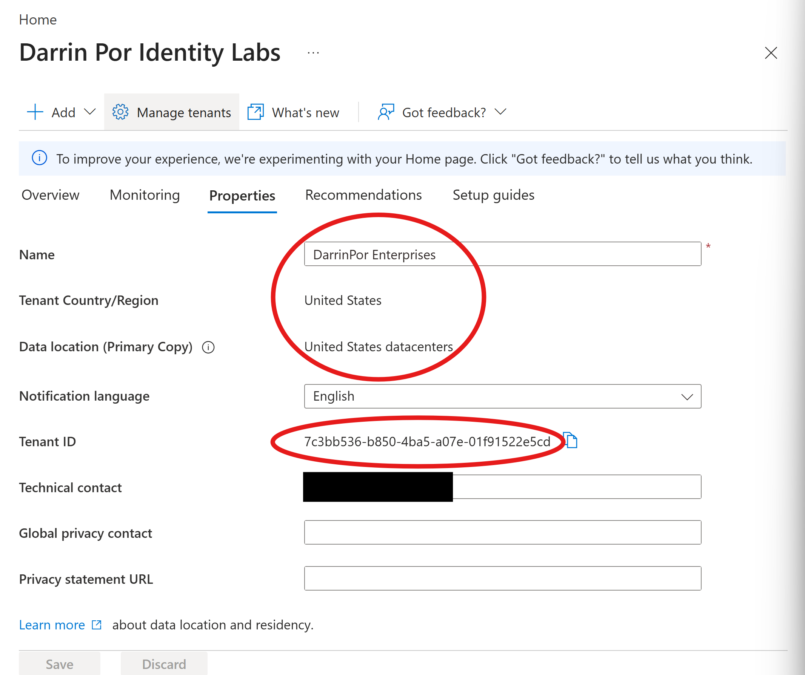
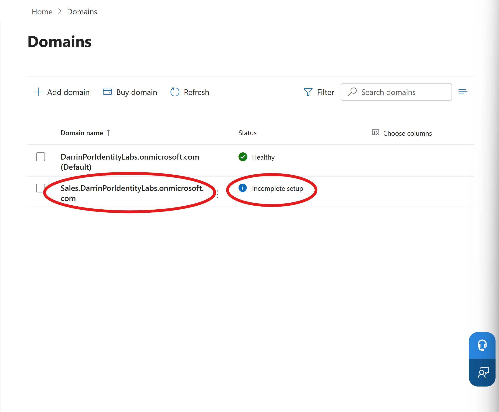
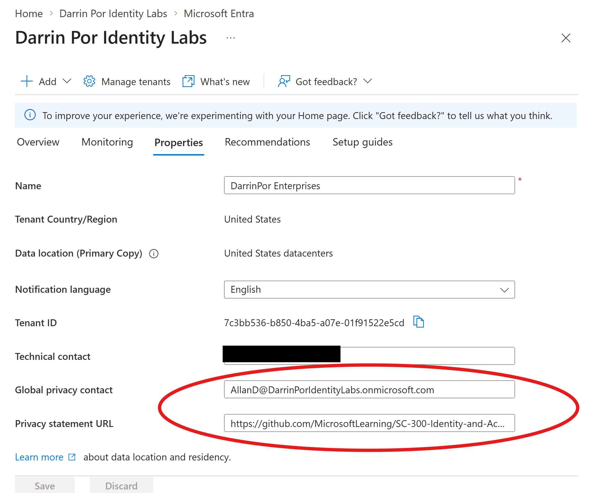

# 🧪 Lab 02: Working with Tenant Properties and Custom Subdomains in Microsoft Entra ID

---

## 1. Executive Summary & Objective

### 🏢 Business Scenario

As an Identity and Access Management (IAM) administrator, managing organization-level identity settings extends far beyond individual user lifecycles. Organizations must establish correct tenant branding, map custom domain namespaces, record immutable tenant identifiers for service integrations, and enforce regulatory compliance (such as GDPR disclosures and privacy contacts) for both internal employees and external B2B guests.

### 🎯 Objective

Configure tenant-level properties, establish custom subdomain namespace routing, record unique tenant identifiers, and implement organizational privacy controls within a Microsoft 365 Developer Tenant using the Microsoft Entra admin center and Microsoft 365 admin center.

* **Target Certification Domain:** Domain 1 — Implement an Identity Management Solution (Tenant Configuration & Governance)


* **Official Lab Reference:** [Microsoft Learn SC-300 Lab 02](https://microsoftlearning.github.io/SC-300-Identity-and-Access-Administrator/Instructions/Labs/Lab_02_WorkingWithTenantProperties.html)

* **Tenant Type:** Microsoft 365 Developer Tenant (Entra ID P2)


---

## 2. Architecture & Control Design

```text
[ Microsoft Entra Admin Center ] ──► [ Tenant Display Name & Properties ] ──► [ Identifier & Region Audit ]
                                                │
                                                ▼
[ Microsoft 365 Admin Center ]   ──► [ Custom Subdomain Routing ]     ──► [ Privacy & B2B Compliance ]

```

### ⚙️ Implementation Scope

| Action / Phase | Target Resource | Configuration & Purpose |
| --- | --- | --- |
| **Custom Subdomain** | `Sales.DarrinPorIdentityLabs.onmicrosoft.com` | Created and registered a regional subdomain via the Microsoft 365 admin center to partition namespace routing.

 |
| **Tenant Properties** | `DarrinPor Enterprises` Tenant | Updated display name, recorded immutable Tenant ID, and verified regional data residency settings.

 |
| **Privacy Configuration** | Global Privacy Contact & URL | Assigned built-in IT administrator `AllanD@...` as the privacy point of contact and linked an organizational privacy statement to prevent unverified B2B guest warnings.

 |

---

## 3. Step-by-Step Implementation Guide

### Phase 1: Creating a Custom Subdomain Name

1. Logged into the **Microsoft Entra admin center** (`[https://entra.microsoft.com](https://entra.microsoft.com)`) using my Global Administrator account.


2. Navigated to **Identity** $\rightarrow$ **Domain names** and selected **+ Add custom domain**.


3. Entered the custom subdomain format (`Sales.DarrinPorIdentityLabs.onmicrosoft.com`). Encountered the administrative restriction notification stating that managing `.onmicrosoft.com` subdomains requires the Microsoft 365 Admin Center.


4. Followed the prompt link to the **Microsoft 365 Admin Center**, navigated to **Domains**, and selected **Add domain**.


5. Re-entered the subdomain string, selected **Use this domain**, and completed the registration wizard (leaving DNS unconfigured as expected in lab environments).


### Phase 2: Updating Tenant Display Name & Core Properties

1. Returned to the **Microsoft Entra admin center**, navigated to **Identity** $\rightarrow$ **Overview** $\rightarrow$ **Properties**.


2. Updated the tenant **Name** from the default setting to `DarrinPor Enterprises`.


3. Reviewed immutable tenant properties, noting that **Country or region** and data residency locations are locked at tenant creation time.


4. Located and securely recorded the unique **Tenant ID** (`7c3bb536-...`) required for future subscription trust relationships.


### Phase 3: Configuring Organizational Privacy Information & Verification

1. Remained within the **Properties** blade of Microsoft Entra ID to establish compliance guardrails.


2. Populated the **Global privacy contact** field with the built-in IT administrator account (`AllanD@DarrinPorIdentityLabs.onmicrosoft.com`).


3. Added the **Privacy statement URL** linking to the sample organizational privacy documentation repository.


> ⚠️ **Security Insight:** Configuring these privacy fields ensures external B2B collaboration guests see a verified organizational privacy policy during consent prompts rather than the default warning text.
> 
> 

4. Verified the implementation by clicking the username in the upper-right corner of the portal, selecting **View Account**, navigating to the **My Account** tab, opening the **Data & Privacy** blade, and inspecting the **Organization's Notice** to confirm the privacy statement linked correctly.


---

## 4. Verification & Audit Evidence

### 📷 Evidence Screenshots

#### 1. Tenant Properties & Identifier Overview

*Figure 2.1: Entra ID Properties blade showing updated display name, immutable Tenant ID, and data location settings.*

#### 2. Custom Subdomain Registration

*Figure 2.2: Microsoft 365 admin center confirming successful addition of the sales subdomain with an incomplete setup DNS status.*

#### 3. Privacy Contact & Statement Integration

*Figure 2.3: Tenant properties displaying the configured Global Privacy Contact and Privacy Statement URL.*

---

## 5. Zero Trust Security & Risk Analysis

### 🛡️ Core Security Controls

* **Namespace Governance:** Partitioning `.onmicrosoft.com` subdomains allows organizations to logically separate business units while maintaining centralized tenant boundaries.


* **B2B Trust & Transparency:** Enforcing strict privacy contact assignments and document links prevents external guest friction, ensuring third-party collaborators have immediate visibility into organizational data handling policies.


* **Immutable Identifiers:** Recognizing that regional data locations and Tenant IDs form the root of trust highlights the importance of rigorous baseline configuration during initial tenant setup.


---

## 6. Rollback & Cleanup Procedures

1. Maintained the updated tenant display name (`DarrinPor Enterprises`) and privacy configurations as baseline parameters required for subsequent Identity Governance labs.
2. Verified that the custom subdomain entry remained intact without active DNS bindings to prevent routing interference.
