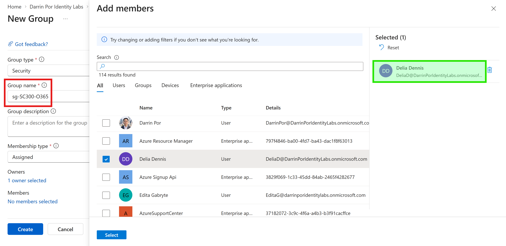
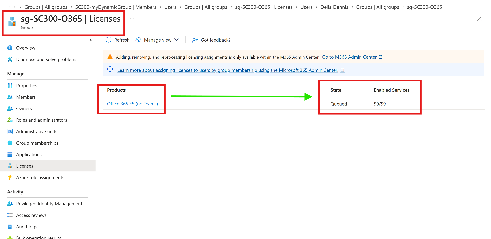
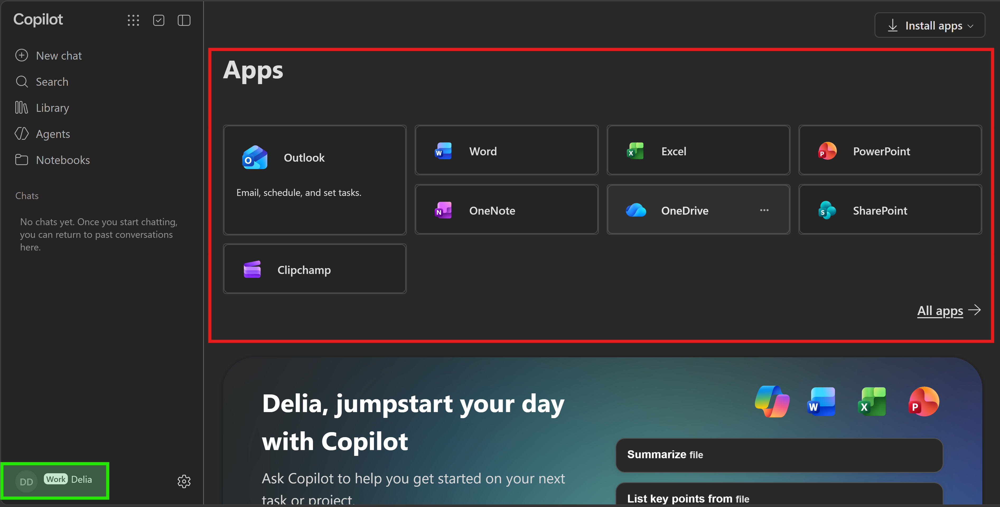
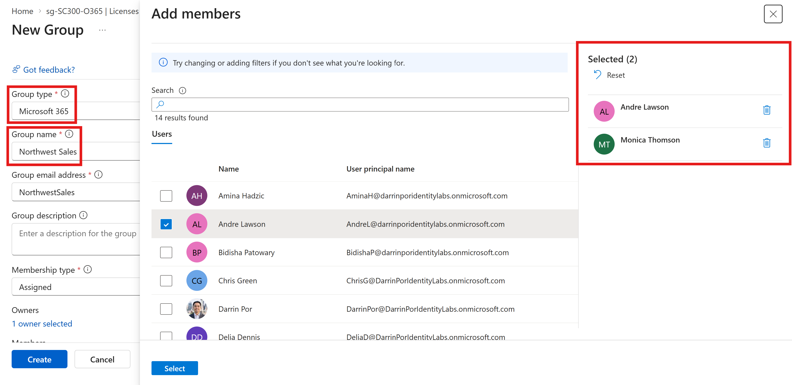
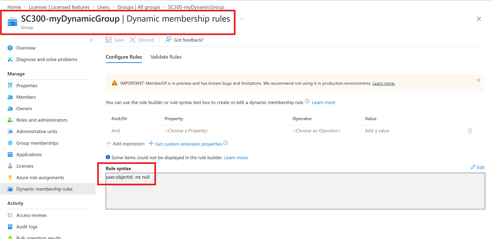
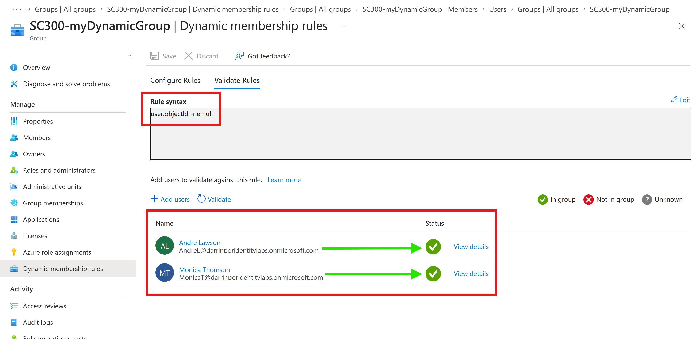

# 🛡️ Lab 03: Managing Groups in Microsoft Entra ID

## 📌 Executive Summary & Overview

In this lab, group management, group-based licensing, and dynamic membership governance capabilities were implemented within a custom Microsoft Entra ID tenant (`darrinporidentitylabs.onmicrosoft.com`). The core goal of this phase was transitioning from manual per-user identity administration to scalable, automated identity management aligned with Microsoft Zero Trust principles.

### Key Objectives Accomplished:

* **Group-Based Licensing:** Configured automated M365 license assignment via security groups (`sg-SC300-O365`) to eliminate direct assignment drift.
* **License Inheritance Verification:** Validated end-user SaaS application access via inherited service plans on target accounts (`Delia Dennis`).
* **Microsoft 365 Group Deployment:** Provisioned collaborative group resources (`Northwest Sales`) with custom bulk-imported identities.
* **Dynamic Group Governance:** Built and validated attribute-driven membership rule logic (`SC300-myDynamicGroup`) using Microsoft Entra ID P2 dynamic rule processing.

---

## 🏗️ Architecture and Control Design

* **Tenant Domain:** `darrinporidentitylabs.onmicrosoft.com`
* **Administrative Role:** Global Administrator
* **Licensing Tier:** Microsoft Entra ID P2 (Active 30-day Trial)
* **Directory Baseline:** 14 custom user objects provisioned via bulk CSV import (Lab 01 baseline).

---

## 🚀 Implementation Steps

### Exercise 1: Group-Based License Assignment & Application Verification

1. Navigated to **Microsoft Entra admin center** → **Identity** → **Groups** → **All groups**.
2. Created Security Group **`sg-SC300-O365`** with **Assigned** membership type and added member **Delia Dennis**.
3. Configured **Licenses** on `sg-SC300-O365` to assign **Office 365 E5 (no Teams)** across all 59 available service plans.
4. Logged into the Microsoft 365 App Launcher (`m365.cloud.microsoft/apps`) under **Delia Dennis** to verify license inheritance and functional app availability.

### Exercise 2: Provisioning Microsoft 365 Groups

1. Navigated to **Groups** → **All groups** → **New group**.
2. Selected **Group type** as **Microsoft 365** and designated Group name as **`Northwest Sales`**.
3. Assigned group ownership and populated group members with custom directory accounts **Andre Lawson** (`AndreL@...`) and **Monica Thomson** (`MonicaT@...`).

### Exercise 3: Dynamic Security Group Creation & Rule Syntax Validation

1. Created a Security Group with **Membership type** configured as **Dynamic User**.
2. Configured the dynamic membership query syntax: `(user.objectId -ne null)`.
3. Executed rule validation tests against custom bulk-imported directory objects.

---

## 🖼️ Verification & Evidence

### Exercise 1 Screenshots

#### `01-security-group-creation.png`

* **Visual Annotations & Highlights:**
  * **Red Box (Group Name):** Highlights group identifier `sg-SC300-O365`.
  * **Green Box (Selected Member):** Highlights user account Delia Dennis (`DeliaD@darrinporidentitylabs.onmicrosoft.com`) selected for initial group membership.
* **Technical Note:** Establishes the target security group used as the administrative container for group-based licensing.

---

#### `02-group-license-assignment.png`

* **Visual Annotations & Highlights:**
  * **Red Box (Header):** Confirms active group licensing blade for `sg-SC300-O365 | Licenses`.
  * **Red Box (Assigned Product):** Highlights Office 365 E5 (no Teams).
  * **Green Arrow & Red Box (State/Services):** Points from the product name directly to `Queued` state and `59/59` enabled service plans.
* **Technical Note:** Demonstrates group-level license binding. Group-based licensing automatically assigns service plan claims to all existing and future members without direct administrative overhead.

---

#### `03-licensed-office-portal.png`

* **Visual Annotations & Highlights:**
  * **Green Box (Identity Badge):** Highlights active session under Delia Dennis (`DD Work Delia`) at `m365.cloud.microsoft/apps`.
  * **Red Box (App Suite):** Outlines populated enterprise SaaS applications including Outlook, Word, Excel, PowerPoint, OneNote, OneDrive, and SharePoint.
* **Technical Note:** Verifies end-to-end cloud provisioning. The background group license assignment successfully granted the target user active access to the underlying SaaS application suite.

---

### Exercise 2 Screenshot

#### `04-m365-group-creation.png`

* **Visual Annotations & Highlights:**
  * **Red Boxes (Left Panel):** Highlights Group type set to `Microsoft 365` and Group name set to `Northwest Sales`.
  * **Red Box (Right Panel):** Outlines the selected member list containing custom accounts Andre Lawson and Monica Thomson.
* **Technical Note:** M365 Groups establish automated lifecycle management and shared resources across linked Microsoft 365 workloads without requiring separate permissions management across Exchange and SharePoint.

---

### Exercise 3 Screenshots

#### `05-dynamic-group-creation.png`

* **Visual Annotations & Highlights:**
  * **Red Box (Header):** Highlights group blade `SC300-myDynamicGroup | Dynamic membership rules`.
  * **Red Box (Rule Syntax):** Highlights expression string `user.objectId -ne null`.
* **Technical Note:** Configures the rule expression. Querying for non-null Object IDs instructs the Entra ID dynamic membership engine to evaluate all active user identities in the tenant.

---

#### `06-dynamic-group-validation.png`

* **Visual Annotations & Highlights:**
  * **Red Box (Top Engine):** Outlines active rule syntax `user.objectId -ne null`.
  * **Red Box (User Results):** Outlines evaluation rows for custom accounts Andre Lawson (`AndreL@...`) and Monica Thomson (`MonicaT@...`).
  * **Green Arrows:** Points directly from each user name to their respective green checkmark status icon.
* **Technical Note:** Confirms rule evaluation accuracy. Both test identities returned an `In group` status, validating attribute processing before saving the rule.

---

## 🛠️ Troubleshooting Logs & Environment Discrepancies

During the execution of Lab 03, several real-world operational behaviors and environment-specific variances occurred. The following details document the root causes and resolutions:

### 1. Group License Assignment Stuck in "Queued" State

* **Observed Behavior:** On the `sg-SC300-O365 | Licenses` blade, the assigned **Office 365 E5 (no Teams)** license displayed an assignment state of **Queued** rather than immediately showing *Active*.
* **Root Cause:** Microsoft Entra ID processes group-based licensing asynchronously in backend background queues. In new or trial tenants, backend service jobs run periodically to re-evaluate token claims, geographic usage location compliance, and license conflicts across group members.
* **Verification & Resolution:**
* Confirmed this is **expected asynchronous cloud behavior** and not an error.
* Verified functional end-to-end inheritance by checking the user object directly (**Users** → **Delia Dennis** → **Licenses** → *Inherited (Group)*) and logging into the user portal (`03-licensed-office-portal.png`), confirming active app provisioning regardless of the background queue state.
* *Operational Shortcut:* If fast reprocessing is required, toggling a sub-service on the license assignment or selecting the license in **Billing** → **Licenses** → **Licensed groups** and clicking **Reprocess** forces an immediate background queue cycle.

### 2. Discrepancy in Dynamic Group Member Count (14/14 vs. Lab Manual's 30/30)

* **Observed Behavior:** Official SC-300 Microsoft lab manuals reference dynamic groups populating 30 pre-seeded demo accounts (e.g., MS-500/SC-300 default tenant datasets). In this lab execution, the dynamic group populated **14 members**.
* **Root Cause & Discrepancy Note:** This lab environment was constructed from a clean-state tenant using a custom CSV bulk-import dataset (from Lab 01) containing exactly **14 active user objects**.
* **Validation Outcome:** The dynamic rule `(user.objectId -ne null)` evaluated across the directory with 100% accuracy, successfully discovering and populating all **14 out of 14 active user accounts** present in the directory.

---

## 🔒 Security Control Analysis & Governance Impact

| Feature / Mechanism | Administrative Overhead | Governance & Zero Trust Alignment |
| --- | --- | --- |
| **Direct License Assignment** | High (manual per-user configuration) | High risk of license drift and over-provisioning. |
| **Group-Based Licensing** | Low (centralized group binding) | Ensures automated, predictable provisioning aligned with RBAC principles. |
| **Dynamic Membership Rules** | Zero ongoing maintenance | Automates identity lifecycle management based on directory attributes. |

---

## 🔄 Rollback & Cleanup Procedures

To return the tenant environment to its baseline state following evaluation:

1. **Remove Group Licenses:** Navigate to **Groups** → **`sg-SC300-O365`** → **Licenses**, select **Office 365 E5 (no Teams)**, and click **Remove license**.
2. **Delete Created Groups:** Delete groups `sg-SC300-O365`, `Northwest Sales`, and `SC300-myDynamicGroup` from **Groups** → **All groups**.

---

## 📊 Summary of Completed Lab Artifacts

| File Name | Exercise Focus | Summary of Visual Focus & Annotations |
| --- | --- | --- |
| **`01-security-group-creation.png`** | Security Group Setup | Group `sg-SC300-O365` name box & selected member `Delia Dennis`. |
| **`02-group-license-assignment.png`** | Group Licensing | Arrow from `Office 365 E5` license product to `Queued` state & `59/59` services. |
| **`03-licensed-office-portal.png`** | App Provisioning | Logged-in session badge for Delia Dennis & active M365 SaaS application launcher. |
| **`04-m365-group-creation.png`** | M365 Group Setup | `Northwest Sales` group creation box & selected members Andre Lawson & Monica Thomson. |
| **`05-dynamic-group-creation.png`** | Dynamic Group Rule | `SC300-myDynamicGroup` rule syntax box `(user.objectId -ne null)`. |
| **`06-dynamic-group-validation.png`** | Rule Evaluation | Green arrows from Andre Lawson & Monica Thomson to successful `In group` checkmarks. |
