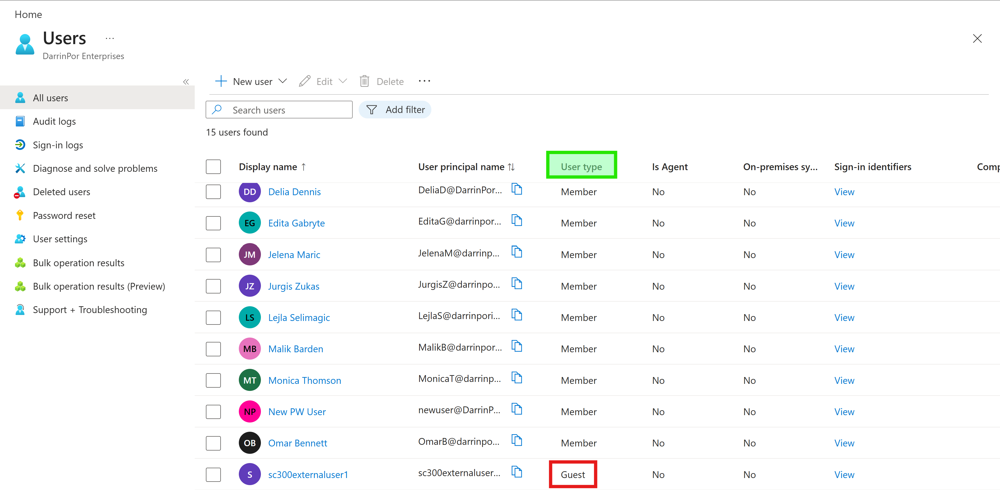
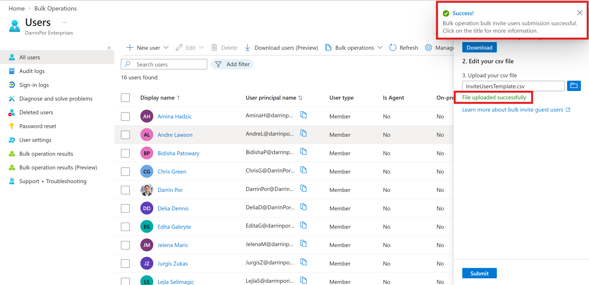
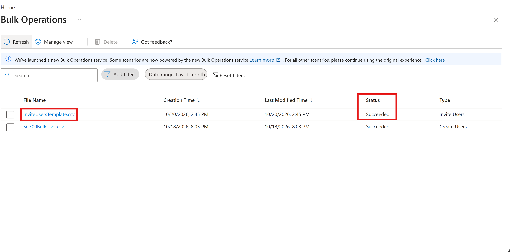

# 🛡️ Lab 05: Add Guest Users to the Directory in Microsoft Entra ID

## 📌 Executive Summary & Overview

In this lab, methods for onboarding external vendor and partner accounts into Microsoft Entra ID for B2B collaboration were implemented within the custom Microsoft Entra ID tenant (`darrinporidentitylabs.onmicrosoft.com`). The core goal of this phase was moving beyond internal user management to securely provision and govern external identities using portal-based invitations, bulk CSV operations, and programmatic Graph PowerShell SDK commands in alignment with Microsoft Zero Trust principles.

### Key Objectives Accomplished:
- **Individual Guest Invitations:** Onboarded external partner accounts directly through the Microsoft Entra admin center with proper guest attribute tagging.
- **Bulk B2B Provisioning:** Scaled guest user onboarding simultaneously using validated CSV templates and Entra bulk operations.
- **Programmatic Guest Provisioning:** Utilized the Microsoft Graph PowerShell SDK (`New-MgInvitation`) to automate and script external user invitations.
- **Identity Governance & Troubleshooting:** Resolved tenant domain restrictions and format validation nuances during batch uploads.

---

## 🏗️ Architecture and Control Design

- **Tenant Domain:** `darrinporidentitylabs.onmicrosoft.com`
- **Administrative Role:** Global Administrator / Guest Inviter
- **Licensing Tier:** Microsoft Entra ID P2 (Active 30-day Trial)
- **Collaboration Scope:** External B2B partner onboarding and lifecycle management.

---

## 🚀 Implementation Steps

### Exercise 1: Add Guest Users to the Directory

#### Task 1: Invite External Guest User
1. Signed in to the **Microsoft Entra admin center** (`https://entra.microsoft.com`) as a Global Administrator or user assigned the Guest Inviter role.
2. Navigated to **Entra ID** → **Users** → **All users** and selected **+ New user** → **Invite external user**.
3. Entered the target external email address (`sc300externaluser1@sc300email.com`), reviewed user properties, and issued the invitation.

### Exercise 2: Invite Guest Users in Bulk & via PowerShell

#### Task 1: Bulk User Invite via CSV
1. Navigated to **Entra ID** → **Users** → **All users** → **Bulk operations** → **Bulk invite**.
2. Downloaded the sample CSV template (`InviteUsersTemplate.csv`), populated the required fields with external partner email addresses, and uploaded the completed file.
3. Monitored job execution under **Users** → **Bulk operation results**.

#### Task 2: Invite Guest Users with Microsoft Graph PowerShell
1. Opened PowerShell (v7.2+) and installed/verified the Microsoft Graph module (`Install-Module Microsoft.Graph -Scope CurrentUser -Verbose`).
2. Authenticated into the tenant with delegated permissions (`Connect-MgGraph -Scopes "User.ReadWrite.All"`).
3. Configured invitation parameters (`$params`) specifying the target invited user email (`admin@fabrikam.com`) and redirect URL (`https://myapp.contoso.com`).
4. Executed the `New-MgInvitation` cmdlet to programmatically generate and dispatch the B2B invitation.

---

## 🖼️ Verification & Evidence

### Exercise 1 Screenshots

#### `01-guest-user-directory-verification.png`

- **Visual Annotations & Highlights:**
  * **Green Box:** Highlights the **User type** directory attribute column.
  * **Red Box:** Highlights **Guest**, confirming proper external identity classification for `sc300externaluser1`.
- **Technical Note:** Confirms that individual B2B guest invitations instantly populate directory objects with proper external attribute tagging.

---

### Exercise 2 Screenshots

#### `02-bulk-invite-file-uploaded.png`

- **Visual Annotations & Highlights:**
  * **Lower Red Box:** Highlights the validation confirmation message **"File uploaded successfully"**.
  * **Upper Red Box:** Highlights the portal toast notification confirming submission of the bulk invite operation.
- **Technical Note:** Validates syntactic correctness of CSV headers, required redirection URL parameters, and external email structures before initiating backend batch jobs.

---

#### `03-bulk-operation-results.png`

- **Visual Annotations & Highlights:**
  * **Left Red Box:** Identifies the executed bulk import file (`InviteUsersTemplate.csv`).
  * **Right Red Box:** Highlights the **Status** column showing **Succeeded** for the **Invite Users** operation type.
- **Technical Note:** Demonstrates scalability for onboarding multiple external partner accounts simultaneously without manual single-user portal entry.

---

## 🛠️ Troubleshooting Logs & Environment Discrepancies

During the execution of Lab 05, the following operational behaviors and environment-specific variances occurred:

### 1. Tenant Domain Restriction on B2B Invites
- **Observed Behavior:** During bulk CSV upload, entering an email address matching the host tenant's domain (`@DarrinPorIdentityLabs.onmicrosoft.com`) resulted in a failed job status.
- **Technical Insight:** Entra ID strictly requires guest accounts to use external domains (e.g., `@gmail.com` or external partner tenant domains) to prevent invalid self-referential B2B invitations.

### 2. Lab Manual Template Discrepancy
- **Observed Behavior:** The lab manual provided a reference to the `Bulk Create Users` template (`version:v1.0` requiring passwords and principal names).
- **Technical Insight:** The actual portal template for `Bulk Invite Users` (`InviteUsersTemplate.csv`) correctly prompts for `inviteeEmail`, `inviteRedirectURL`, and `sendEmail` parameters without password requirements.

---

## 🔒 Security Control Analysis & Governance Impact

| Feature / Mechanism | Administrative Workflow | Zero Trust Alignment & Security Impact |
| --- | --- | --- |
| **Portal B2B Invitation** | Manual single-user entry | Ensures strict administrative verification for individual external vendor access. |
| **Bulk CSV Import** | Batch file upload | Scales multi-user partner onboarding while enforcing syntax and domain boundaries. |
| **Graph PowerShell SDK** | Programmatic scripting (`New-MgInvitation`) | Enables automated provisioning pipelines for identity synchronization and DevOps integration. |

---

## 🔄 Rollback & Cleanup Procedures

1. Maintained invited external guest user accounts (`sc300externaluser1`, `admin@fabrikam.com`, and bulk test records) as active identity objects to support subsequent permission and governance labs.
2. Verified that guest accounts correctly retained external scoping attributes (`Guest` user type) without administrative role assignments.

---

## 📊 Summary of Completed Lab Artifacts

| File Name | Exercise Focus | Summary of Visual Focus & Annotations |
| --- | --- | --- |
| **`01-guest-user-directory-verification.png`** | Portal Guest Invite | Green box on **User type** header and red box highlighting **Guest** status. |
| **`02-bulk-invite-file-uploaded.png`** | Bulk CSV Upload | Lower red box on **File uploaded successfully** and upper toast notification. |
| **`03-bulk-operation-results.png`** | Operation Status | Red boxes identifying `InviteUsersTemplate.csv` and **Succeeded** status. |
