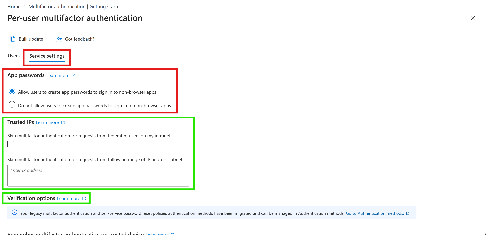
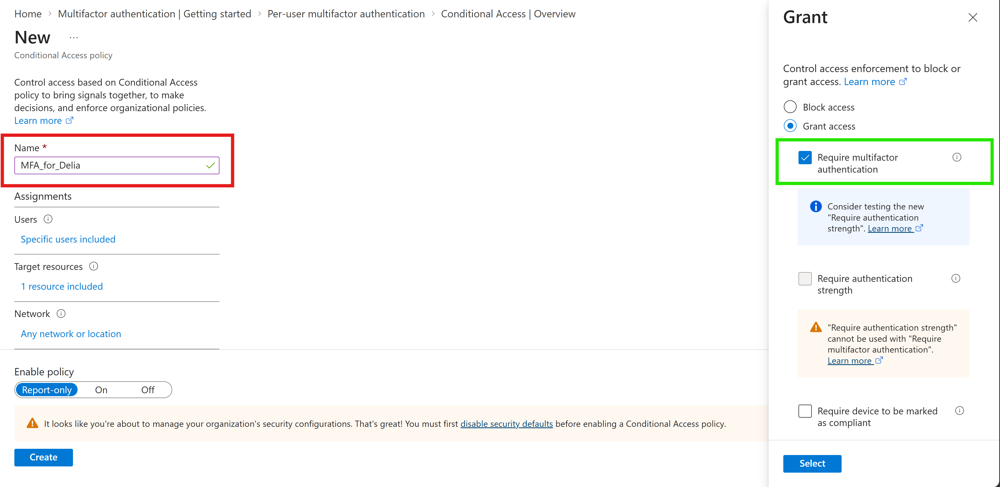
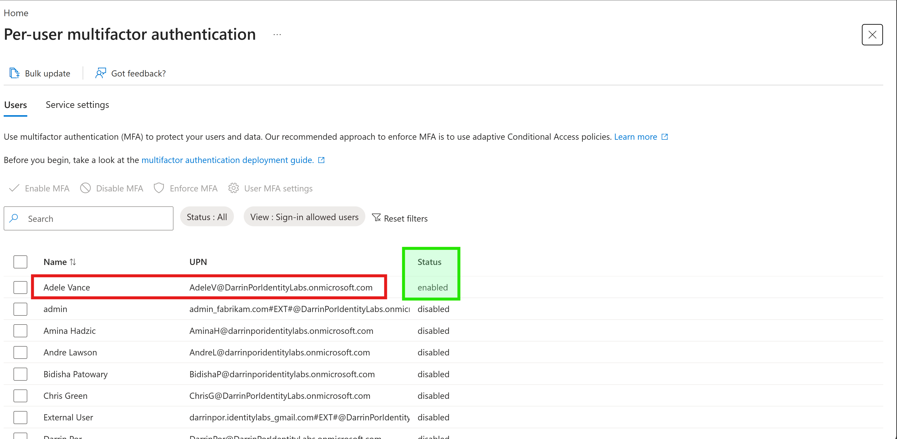

# 🔐 Lab 08: Enable Multi-Factor Authentication

## 📋 1. Executive Summary & Objective
Multi-Factor Authentication (MFA) is a core foundational control within the Zero Trust security framework, designed to defend against password-based attacks such as credential stuffing, phishing, and password spraying. The objective of this lab is to review Microsoft Entra MFA administration capabilities, enforce modern adaptive access controls via Conditional Access policies, and manage legacy per-user MFA configurations across tenant accounts.

In this scenario, two targeted MFA enforcement methods were deployed:
1. **Conditional Access Policy (`MFA_for_Delia`):** Dynamically requires multi-factor authentication for user **Delia Dennis** when accessing Office 365 cloud resources across all network locations.
2. **Per-User MFA Configuration:** Manually enables per-user MFA for target user **Adele Vance** through the Microsoft Entra user settings administration portal.

---

## 🏗️ 2. Architecture & Control Design


```

+-------------------------------------------------------------------------------------------------+
|                                     AUTHENTICATION INITIATION                                   |
|                                                                                                 |
|   Target Users:                                                                                 |
|     - Delia Dennis (Conditional Access Targeted)                                     |
|     - Adele Vance (Per-User MFA Targeted)                                            |
+-----------------------------------+-----------------------------------------------------+   |
|                                                     |
v                                                     |
+-------------------------------------------------------------------------------------------------+
|                                    MICROSOFT ENTRA ID EVALUATION                                 |
|                                                                                                 |
|   +-----------------------------------------------------------------------------------------+   |
|   | Conditional Access Engine                                                                |   |
|   |  - Policy: MFA_for_Delia                                                     |   |
|   |  - Target App: Office 365                                                    |   |
|   |  - Network Condition: Any network or location                                |   |
|   |  - Access Requirement: Grant -> Require Multifactor Authentication           |   |
|   +-----------------------------------+-----------------------------------------------------+   |
|                                       |                                                         |
|   +-----------------------------------+-----------------------------------------------------+   |
|   | Legacy Per-User MFA Service Engine                                       |   |
|   |  - Account: Adele Vance                                                      |   |
|   |  - State: Enabled                                                            |   |
|   +-----------------------------------+-----------------------------------------------------+   |
+---------------------------------------|---------------------------------------------------------+
| Challenge Issued
v
+-------------------------------------------------------------------------------------------------+
|                                    MFA VERIFICATION STEP                                        |
|                                                                                                 |
|   User Prompted to Register/Authenticate via Microsoft Authenticator / Secondary Auth Method    |
+---------------------------------------|---------------------------------------------------------+
| Access Granted Upon Proof
v
+-------------------------------------------------------------------------------------------------+
|                                    RESOURCE ACCESS AUTHORIZED                                   |
|                                                                                                 |
|   Authenticated Portal Landing: [https://www.office.com](https://www.office.com)                               |
+-------------------------------------------------------------------------------------------------+

```

---

## ⚙️ 3. Step-by-Step Implementation

### Task 1: Review Azure Multi-Factor Authentication Settings
1. Navigated to the Microsoft Entra admin center (`https://entra.microsoft.com`) using a Global Administrator account.
2. Used the search feature to locate **Multifactor authentication** under Microsoft Entra ID.
3. On the **Getting started** page, selected **Additional cloud-based multifactor authentication settings** under **Configure**.
4. Reviewed cloud-based MFA configuration settings including **App passwords**, **Trusted IPs**, and **Verification options**.

### Task 2: Configure Conditional Access Policy for Delia Dennis
1. Switched back to the Microsoft Entra admin center and navigated to **Entra ID** > **Conditional Access**.
2. Selected **+ New policy** and named the policy **`MFA_for_Delia`**.
3. Under **Assignments** > **Users or agents**, included targeted user **Delia Dennis**.
4. Under **Target resources**, selected **Resources (formerly cloud apps)** > **Include** > **Select resources**, and chose **Office 365**.
5. Under **Conditions** > **Network**, enabled configuration and set location scope to **Any network or location**.
6. Under **Access controls** > **Grant**, selected **Grant access**, checked **Require multifactor authentication**, and confirmed settings.
7. Toggled **Enable policy** to **On** and selected **Create**.

### Task 3: Configure Per-User Multi-Factor Authentication for Adele Vance
1. Navigated to **Entra ID** > **Users** > **All users**.
2. Selected **Per-user MFA** from the top command bar.
3. In the per-user MFA settings tab, located and selected **Adele Vance**.
4. Clicked **Enable MFA** under the quick steps pane, confirmed the prompt, and verified the account status updated to **enabled**.

---

## 📸 4. Verification & Audit Evidence

### 1. Cloud-Based MFA Service Settings Configuration
- **File:** `01-mfa-service-settings.png`
- **Path:** `Lab-08-Enable-Multi-Factor-Authentication/screenshots/01-mfa-service-settings.png`
- **Visual Focus:** Outline the **Service settings** tab and **App passwords** configuration block in a **Red Box**; highlight **Trusted IPs** and **Verification options** blocks in a **Green Box**.



### 2. Conditional Access Enforcement Policy (`MFA_for_Delia`)
- **File:** `02-conditional-access-mfa-delia.png`
- **Path:** `Lab-08-Enable-Multi-Factor-Authentication/screenshots/02-conditional-access-mfa-delia.png`
- **Visual Focus:** Outline the policy name **`MFA_for_Delia`** in a **Red Box**; highlight the **Require multifactor authentication** grant control in a **Green Box**.



### 3. Per-User MFA Status Confirmation for Adele Vance
- **File:** `03-per-user-mfa-adele.png`
- **Path:** `Lab-08-Enable-Multi-Factor-Authentication/screenshots/03-per-user-mfa-adele.png`
- **Visual Focus:** Outline **Adele Vance** in a **Red Box** under the user directory list; highlight the **enabled** status badge in a **Green Box**.



---

## 🔒 5. Zero Trust & Security Analysis

| Security Control | Threat Mitigation & Risk Assessment |
| --- | --- |
| **Adaptive Access Enforcement** | Replaces static entry barriers with contextual evaluation, requiring explicit secondary verification before granting session tokens to target cloud resources. |
| **Phishing & Credential Defense** | Mitigates compromised password threats by requiring proof of possession or biometric verification alongside traditional knowledge credentials. |
| **Centralized Policy Management** | Shifts authentication requirements from static per-user states toward centralized Conditional Access policies, simplifying management and audit visibility. |

---

## 🧹 6. Rollback & Cleanup

To cleanly remove the MFA testing artifacts and restore default tenant security configuration, execute the following portal cleanup steps:

### Portal Cleanup

1. **Remove Conditional Access Policy:**
   - Navigate to **Entra ID** > **Conditional Access** > **Policies**.
   - Select **`MFA_for_Delia`**, click **Delete**, and confirm removal.

2. **Disable Per-User MFA for Adele Vance:**
   - Navigate to **Entra ID** > **Users** > **Per-user MFA**.
   - Select **Adele Vance**, click **Disable MFA** under quick steps, and confirm.

---

## 📝 Troubleshooting Logs & Environmental Discrepancies

- **Security Defaults Conflicts:** Enabling Conditional Access policies requires tenant Security Defaults to be disabled first. If Security Defaults remain active, Conditional Access policy enforcement may be restricted.
- **Authentication Method Management Migration:** Verification options in legacy per-user MFA service settings display a migration notice indicating that verification methods are now centrally governed under Entra ID **Authentication methods** policies.
