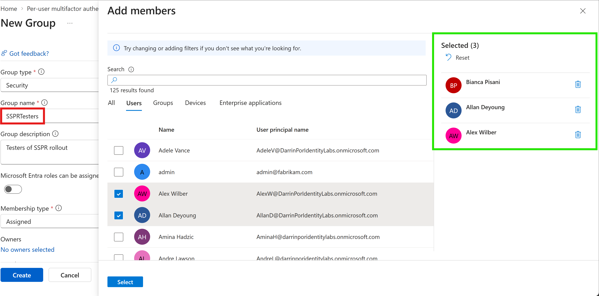
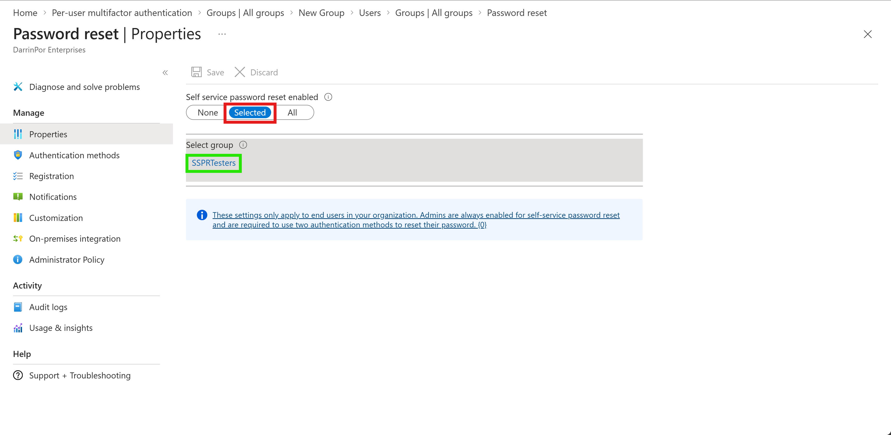
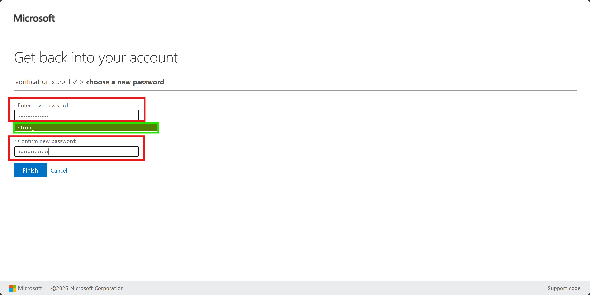
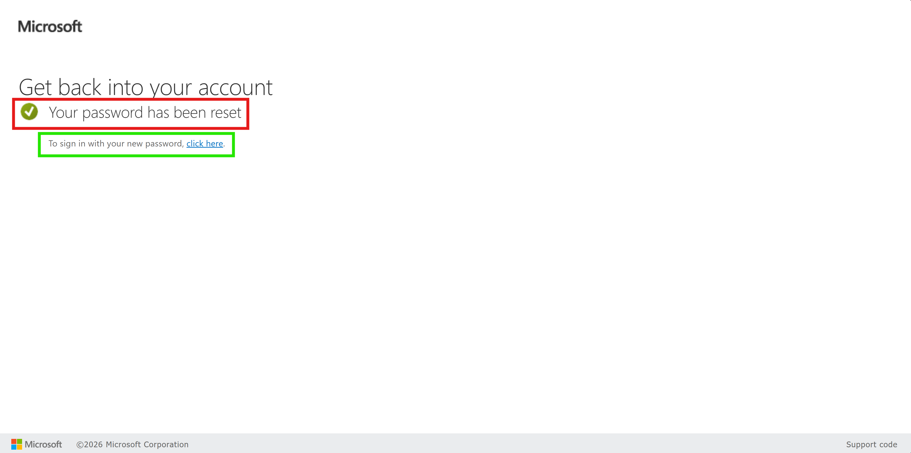

# 🔑 Lab 09: Configure and Deploy Self-Service Password Reset (SSPR)

## 📋 1. Executive Summary & Objective
Self-Service Password Reset (SSPR) is a critical identity governance and access management feature within Microsoft Entra ID that empowers users to reset their passwords without administrative intervention. The objective of this lab is to scope SSPR deployment to a dedicated security group (`SSPRTesters`), configure multi-factor authentication registration requirements, validate the end-user password reset flow, and verify that unassigned users are restricted from executing self-service resets.

In this scenario, SSPR was deployed using a phased rollout approach:
1. **Targeted Group Provisioning:** Created the security group **`SSPRTesters`** and provisioned member accounts (`Alex Wilber`, `Allan Deyoung`, and `Bianca Pisani`).
2. **SSPR Policy Scope:** Configured SSPR properties to enforce password reset capabilities strictly for members of the `SSPRTesters` group.
3. **Authentication & Reset Validation:** Registered test user **Allan Deyoung** for SSPR/MFA using the Microsoft Authenticator app and successfully validated the self-service reset wizard.

---

## 🏗️ 2. Architecture & Control Design


```

+-------------------------------------------------------------------------------------------------+
|                                     SSPR SCOPE CONFIGURATION                                    |
|                                                                                                 |
|   Security Group: SSPRTesters                                                        |
|     - Members: Alex Wilber, Allan Deyoung (AllanD), Bianca Pisani                   |
+-----------------------------------+-----------------------------------------------------+   |
|                                                     |
v                                                     |
+-------------------------------------------------------------------------------------------------+
|                               MICROSOFT ENTRA ID SSPR POLICY ENGINE                             |
|                                                                                                 |
|   Policy State: Enabled (Selected Group Scope)                                       |
|   Authentication Methods: Microsoft Authenticator / Mobile Phone Verification     |
+-----------------------------------+-----------------------------------------------------+   |
|                                                     |
+-----------------------+-----------------------+                             |
|                                               |                             |
v (Authorized Member)                           v (Unauthorized User)         |
+---------------------------------------+   +---------------------------------------+     |
| Allan Deyoung (AllanD)                |   | Grady A (Out of Scope)                |     |
| - Accesses portal.azure.com           |   | - Accesses portal.azure.com           |     |
| - Triggers "Forgot my password"       |   | - Triggers "Forgot my password"       |     |
| - Completes MFA verification code     |   | - Request blocked by policy scope     |     |
| - Successfully resets password        |   | - Requires administrator intervention |     |
+---------------------------------------+   +---------------------------------------+     |

```

---

## ⚙️ 3. Step-by-Step Implementation

### Task 1: Create Security Group and Provision Test Users
1. Logged into the Microsoft Entra admin center (`https://entra.microsoft.com`) using a Global Administrator account.
2. Navigated to **Entra ID** > **Groups** > **All groups** and selected **New Group**.
3. Configured group parameters:
   - **Group type:** Security
   - **Group name:** `SSPRTesters`
   - **Group description:** Testers of SSPR rollout
   - **Membership type:** Assigned
4. Manually provisioned and added member accounts (`Alex Wilber`, `Allan Deyoung`, and `Bianca Pisani`) to the group since they were not pre-existing in the baseline tenant directory.
5. Selected **Create**.

### Task 2: Enable SSPR for the Target Group
1. Navigated to **Entra ID** > **Password reset**.
2. Under the **Properties** blade, set **Self service password reset enabled** to **Selected**.
3. Selected **Select group**, chose the **`SSPRTesters`** group, and saved the configuration.
4. Reviewed default configuration blades under **Manage**, including **Authentication methods** (ensuring phone/Authenticator app options are available), **Registration**, and **Notifications**.

### Task 3: Register for SSPR with Allan Deyoung
1. Opened an InPrivate browser session and navigated to `https://aka.ms/ssprsetup`.
2. Signed in as **`AllanD@<your-domain>.onmicrosoft.com`** using the assigned password.
3. Followed the setup prompts to register the account with the **Microsoft Authenticator** app by scanning the QR code.
4. Completed registration and selected **Done**.

### Task 4: Test SSPR Password Reset Workflow
1. Opened a new InPrivate browser window and navigated to `https://portal.azure.com`.
2. Entered **`AllanD@<your-domain>.onmicrosoft.com`**, selected **Next**, and clicked **Forgot my password**.
3. Completed verification by entering the code generated from the Microsoft Authenticator app.
4. Entered and confirmed a new secure password on the password complexity screen and completed the reset wizard.
5. Verified successful login to the portal using the new password and authentication method.

### Task 5: Test SSPR Restriction for Unassigned Users
1. Opened an InPrivate browser window and attempted to sign into `https://portal.azure.com` as **Grady A** (an account outside the `SSPRTesters` group).
2. Clicked **Forgot my password** and verified that the SSPR policy blocked the request, noting that unassigned users cannot self-service reset passwords and must contact an administrator.

---

## 📸 4. Verification & Audit Evidence

### 1. SSPR Security Group Configuration (`SSPRTesters`)
- **File:** `01-sspr-testers-group.png`
- **Path:** `Lab-09-Configure-and-Deploy-Self-Service-Password-Reset/screenshots/01-sspr-testers-group.png`
- **Visual Focus:** Outline the group name **`SSPRTesters`** in a **Red Box** and highlight the selected members count (`Alex Wilber`, `Allan Deyoung`, `Bianca Pisani`) in a **Green Box**.



### 2. SSPR Properties & Group Scope Binding
- **File:** `02-sspr-properties-enabled.png`
- **Path:** `Lab-09-Configure-and-Deploy-Self-Service-Password-Reset/screenshots/02-sspr-properties-enabled.png`
- **Visual Focus:** Outline the **Selected** toggle under Self-service password reset enabled in a **Red Box** and highlight the targeted group **`SSPRTesters`** in a **Green Box**.



### 3. SSPR Password Complexity & Entry Screen
- **File:** `03-sspr-password-entry.png`
- **Path:** `Lab-09-Configure-and-Deploy-Self-Service-Password-Reset/screenshots/03-sspr-password-entry.png`
- **Visual Focus:** Outline the **Enter new password** fields in a **Red Box** and highlight the green **"strong" complexity meter** in a **Green Box**.



### 4. SSPR Password Reset Success Confirmation
- **File:** `04-sspr-reset-success.png`
- **Path:** `Lab-09-Configure-and-Deploy-Self-Service-Password-Reset/screenshots/04-sspr-reset-success.png`
- **Visual Focus:** Outline the **Your password has been reset** success banner in a **Red Box** and highlight the **click here** sign-in link in a **Green Box**.



---

## 🔒 5. Zero Trust & Security Analysis

| Security Control | Threat Mitigation & Risk Assessment |
| :--- | :--- |
| **Scoped Phased Rollouts** | Restricts self-service account recovery capabilities strictly to authorized security groups (`SSPRTesters`), preventing unauthorized accounts from abusing reset portals. |
| **Multi-Factor Verification Requirement** | Mandates proof of possession via secondary verification factors (such as the Microsoft Authenticator app) before resetting primary credentials. |
| **Helpdesk Load Reduction** | Automates credential recovery workflows for authorized personnel while preserving strict administrative oversight for unassigned users. |

---

## 🧹 6. Rollback & Cleanup

To cleanly remove the SSPR testing artifacts and restore default tenant security configuration, execute the following portal cleanup steps:

### Portal Cleanup

1. **Disable SSPR Scope:**
   - Navigate to **Entra ID** > **Password reset** > **Properties**.
   - Set **Self service password reset enabled** to **None**, and select **Save**.

2. **Delete Test Group and Users:**
   - Navigate to **Entra ID** > **Groups** > **All groups**, select **`SSPRTesters`**, and delete the group.
   - Navigate to **Entra ID** > **Users** > **All users**, delete the manually provisioned test accounts (`Alex Wilber`, `Allan Deyoung`, `Bianca Pisani`), and permanently purge them from **Deleted users**.

---

## 📝 Troubleshooting Logs & Environmental Discrepancies

- **Manual User Provisioning:** Default test accounts (`Alex Wilber`, `Allan Deyoung`, and `Bianca Pisani`) were not pre-populated in the tenant directory and were manually provisioned to fulfill group membership prerequisites.
- **Missing Baseline Group (`SSPRSecurityGroupUsers`):** The lab instructions reference replacing an existing `SSPRSecurityGroupUsers` group during property configuration; however, this group did not exist in the tenant environment. Proceeding directly to assign the newly created `SSPRTesters` group completed successfully without configuration errors.
- **Unassigned User Access Blocking:** Verification testing with unassigned accounts (such as Grady A) correctly triggered access denial, confirming that SSPR security boundaries properly enforce scoping restrictions.
