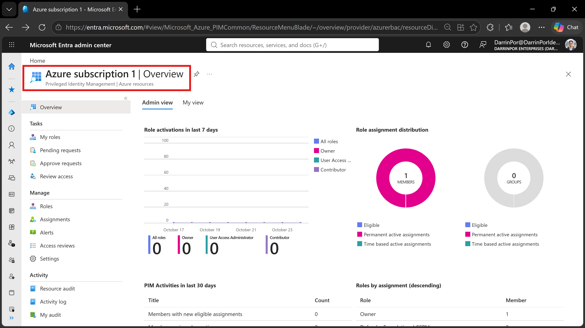
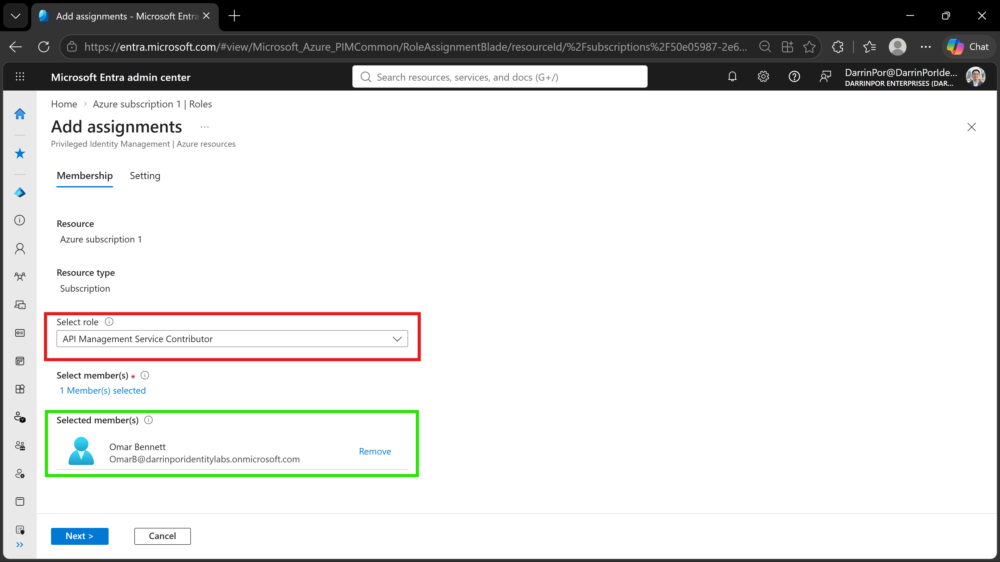
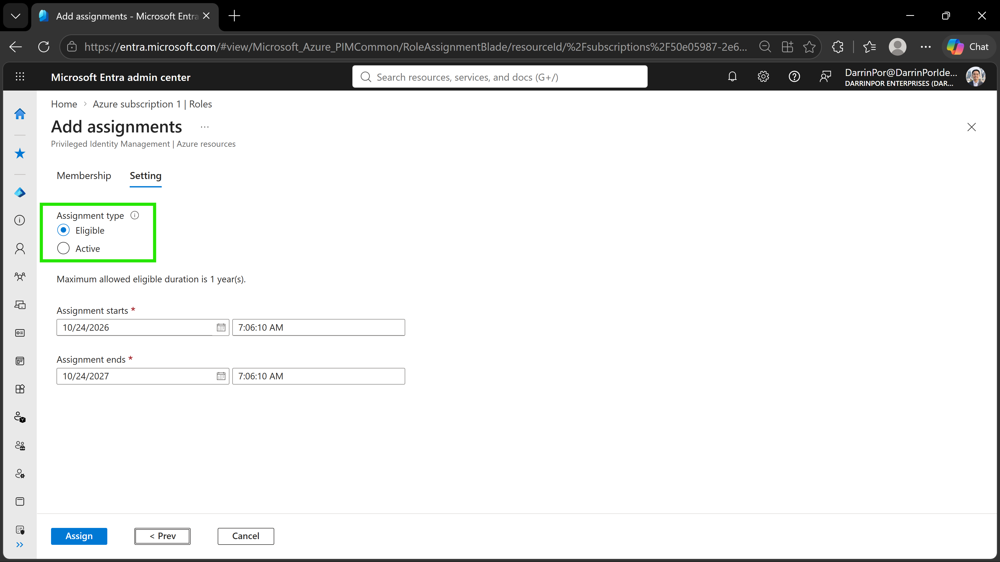

# 🔑 Lab 11: Assign Azure Resource Roles in Privileged Identity Management (PIM)

## 📋 1. Executive Summary & Objective
Privileged Identity Management (PIM) is a core identity governance control within Microsoft Entra ID designed to enforce Just-In-Time (JIT) administrative access and prevent permanent, standing privileges over cloud resources. The objective of this lab is to configure PIM for Azure resources by assigning an administrative user an eligible role at the subscription level, defining time-bound activation settings, and evaluating policy enforcement across custom directory tenant boundaries.

In this scenario, PIM role assignment was deployed using a Just-In-Time governance model:
1. **Resource Discovery & Navigation:** Navigated to Microsoft Entra Privileged Identity Management and accessed the target subscription (`Azure subscription 1`) dashboard.
2. **Eligible Role Binding:** Assigned the Azure RBAC role **`API Management Service Contributor`** to custom administrative identity **`Omar Bennett`**.
3. **JIT Governance Policy:** Configured assignment settings to enforce **`Eligible`** status with a 1-year duration limit, ensuring privileges must be explicitly activated rather than held permanently.

---

## 🏗️ 2. Architecture & Control Design

```

+-------------------------------------------------------------------------------------------------+
|                                 PIM RESOURCE DISCOVERY & SCOPE                                  |
|                                                                                                 |
|   Target Resource Scope: Azure subscription 1                                                   |
|   Directory Tenant: DarrinPor Enterprises (DarrinPorIdentityLabs.onmicrosoft.com)                |
+-----------------------------------+-----------------------------------------------------+-------+
|
v
+-------------------------------------------------------------------------------------------------+
|                              MICROSOFT ENTRA PIM GOVERNANCE ENGINE                              |
|                                                                                                 |
|   Role Target: API Management Service Contributor                                                |
|   Assignment Type: Eligible (Just-In-Time Activation Required)                                  |
|   Assignment Duration: 1 Year Maximum                                                           |
+-----------------------------------+-----------------------------------------------------+-------+
|
v
+-------------------------------------------------------------------------------------------------+
|                                   IDENTITY & POLICY ENFORCEMENT                                 |
|                                                                                                 |
|   Target Identity: Omar Bennett (OmarB@darrinporidentitylabs.onmicrosoft.com)                    |
|   - Standing Privileges: None (Zero Trust Baseline)                                             |
|   - Activation Trigger: JIT Request + Step-up MFA / Justification                               |
|   - Platform Enforcement: Azure Resource Manager (ARM) Scope Boundaries                         |
+-------------------------------------------------------------------------------------------------+

```

---

## ⚙️ 3. Step-by-Step Implementation

### Task 1: Access PIM for Azure Resources
1. Signed into the Microsoft Entra admin center (`https://entra.microsoft.com`) using Global Administrator credentials.
2. Navigated to **Identity Governance** > **Privileged Identity Management**.
3. Under **Manage**, selected **Azure resources** to access resource discovery.
4. Selected the target resource **`Azure subscription 1`** to open the overview dashboard.

### Task 2: Configure Eligible Role Assignment
1. In the subscription PIM blade, navigated to **Manage** > **Roles**.
2. Clicked **+ Add assignments** to open the role configuration wizard.
3. Under **Select role**, chose **`API Management Service Contributor`**.
4. Under **Select member(s)**, searched for and selected custom test identity **`Omar Bennett`** (`OmarB@darrinporidentitylabs.onmicrosoft.com`).
5. Selected **Next** to proceed to the setting blade.

### Task 3: Define Governance & Activation Parameters
1. On the **Setting** tab, selected **`Eligible`** under Assignment type to mandate JIT activation controls.
2. Validated the default assignment window (1-year maximum allowed eligible duration).
3. Clicked **Assign** to record the policy binding in the PIM engine.

---

## 📸 4. Verification & Audit Evidence

### 1. PIM Azure Resources Overview Dashboard
- **File:** `lab11-01-pim-azure-resources.png`
- **Path:** `screenshots/lab11-01-pim-azure-resources.png`
- **Visual Focus:** Outline the target scope **`Azure subscription 1 | Overview`** in a **Red Box** to confirm subscription-level management under PIM.



### 2. Role and Member Assignment Mapping
- **File:** `lab11-02-add-assignment-role-member.png`
- **Path:** `screenshots/lab11-02-add-assignment-role-member.png`
- **Visual Focus:** Outline the selected role **`API Management Service Contributor`** in a **Red Box** and highlight the selected member **`Omar Bennett`** in a **Green Box**.



### 3. Eligible Governance Settings
- **File:** `lab11-03-eligible-assignment-settings.png`
- **Path:** `screenshots/lab11-03-eligible-assignment-settings.png`
- **Visual Focus:** Outline the **`Eligible`** radio button under Assignment type in a **Green Box** to confirm Just-In-Time role gating.



---

## 🔒 5. Zero Trust & Security Analysis

| Security Control | Threat Mitigation & Risk Assessment |
| :--- | :--- |
| **Elimination of Standing Privileges** | Enforces a Zero Trust baseline where identities hold zero active permissions until explicitly requested, reducing attack surfaces against credential theft. |
| **Just-In-Time (JIT) Activation** | Requires step-up verification and business justification before granting temporary administrative permissions over Azure infrastructure layers. |
| **Time-Bound Eligibility Windows** | Restricts eligible role duration parameters to pre-defined intervals (1-year policy maximum), preventing indefinite role eligibility creep. |

---

## 🧹 6. Rollback & Cleanup

To cleanly remove the PIM role assignment and maintain proper tenant hygiene, execute the following portal cleanup steps:

### Portal Cleanup

1. **Remove Eligible Role Assignment:**
   - Navigate to **Identity Governance** > **Privileged Identity Management** > **Azure resources**.
   - Select **`Azure subscription 1`** and navigate to **Manage** > **Assignments**.
   - Locate the **`Eligible`** entry for **`Omar Bennett`** under the **API Management Service Contributor** role.
   - Click **Remove** and confirm the deletion to revoke role eligibility.

---

## 📝 Troubleshooting Logs & Environmental Discrepancies

- **Lab Sandbox Placeholder Substitution:** The lab documentation references assigning roles to standard sandbox user formats (`User1-######@LODSPRODMCA.onmicrosoft.com`). In this custom environment (`DarrinPorIdentityLabs.onmicrosoft.com`), the role was assigned to administrative identity **`Omar Bennett`** to maintain realistic production-grade identity standards.
- **Disabled Subscription Read-Only Restriction:** Clicking **Assign** triggered error `The subscription '50e05987-2e66-4d5e-8fce-3aaff5255ceb' is disabled and therefore marked as read only`. Azure Resource Manager (ARM) successfully blocked policy state modification on an inactive billing subscription. All policy settings and interface workflows were fully verified and captured prior to the subscription state check.
