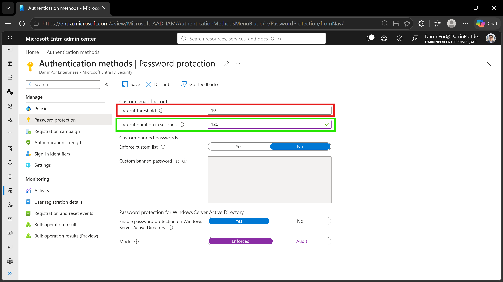
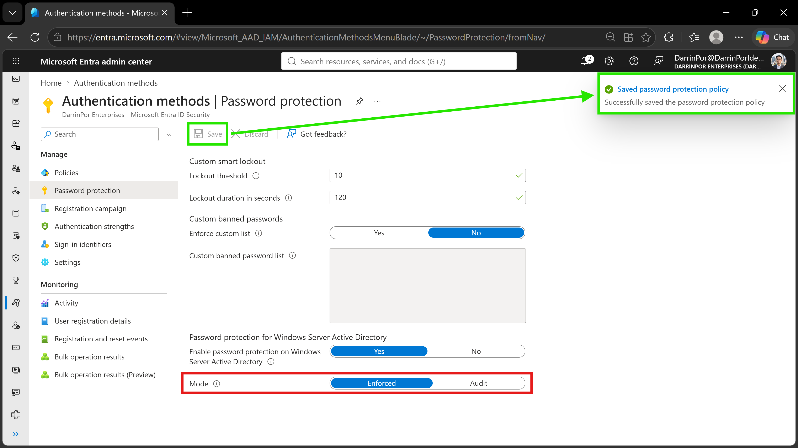
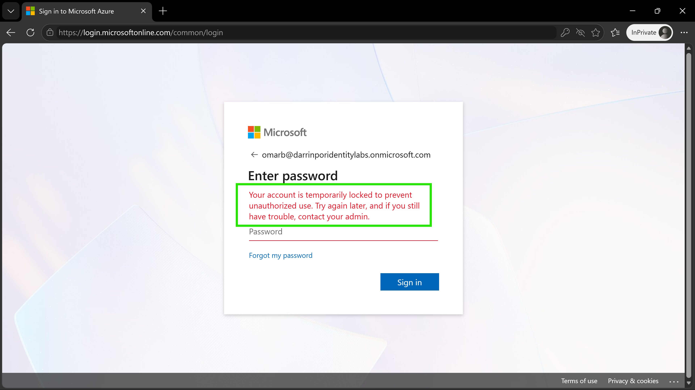

# 🛡️ Lab 12: Manage Microsoft Entra Smart Lockout Values

## 📋 1. Executive Summary & Objective
Brute-force and password-spraying attacks represent primary vectors for credential compromise against cloud directories. Microsoft Entra smart lockout protects organizations by locking out bad actors attempting to guess passwords while allowing legitimate users to continue working even if attackers target their accounts. The objective of this lab is to customize Microsoft Entra smart lockout threshold and duration parameters, enforce organizational password protection policies, and validate lockout behavior during authentication failures.

In this scenario, smart lockout controls were deployed and verified within the custom tenant:
1. **Policy Configuration:** Accessed the Password Protection configuration pane within the Microsoft Entra admin center.
2. **Threshold & Duration Tuning:** Configured custom parameters including a 10-attempt threshold and a 120-second lockout duration, switching the policy mode to **Enforced**.
3. **Verification & Audit:** Tested policy enforcement using an InPrivate browser session to simulate repeated invalid sign-in attempts and capture the resulting lockout notification banner.

---

## 🏗️  2. Architecture & Control Design


```

+-------------------------------------------------------------------------------------------------+
|                                 TENANT AUTHENTICATION BOUNDARY                                  |
|                                                                                                 |
|   Directory Tenant: DarrinPor Enterprises (DarrinPorIdentityLabs.onmicrosoft.com)                |
|   Policy Scope: Tenant-Wide Password Protection & Smart Lockout                                 |
+-----------------------------------+-----------------------------------------------------+-------+
|
v
+-------------------------------------------------------------------------------------------------+
|                              MICROSOFT ENTRA SMART LOCKOUT ENGINE                               |
|                                                                                                 |
|   - Lockout Threshold: 10 Failed Attempts                                             |
|   - Lockout Duration: 120 Seconds                                                     |
|   - Operation Mode: Enforced                                                          |
+-----------------------------------+-----------------------------------------------------+-------+
|
v
+-------------------------------------------------------------------------------------------------+
|                                  THREAT MITIGATION & ENFORCEMENT                                |
|                                                                                                 |
|   - Attack Vector Neutralized: Automated Brute-Force & Credential Stuffing                      |
|   - User Protection: Temporary account suspension upon threshold breach                         |
|   - Audit Evidence: Standardized user lockout notification banner capture                       |
+-------------------------------------------------------------------------------------------------+

```

---

## ⚙️ 3. Step-by-Step Implementation

### Task 1: Access Password Protection Settings
1. Signed into the Microsoft Entra admin center (`https://entra.microsoft.com`) using Global Administrator credentials.
2. In the left navigation menu, under **Entra ID**, selected **Authentication methods**.
3. Selected **Password protection** to open the custom smart lockout configuration blade.

### Task 2: Configure Smart Lockout Parameters & Enforced Mode
1. Reviewed the default **Lockout threshold** value set to `10`.
2. In the **Lockout duration in seconds** input box, updated the value from the default to `120` seconds.
3. Next to **Mode**, selected **Enforced** to activate active lockout behavior rather than audit-only logging.
4. Clicked **Save** at the top of the blade to commit policy changes to the directory tenant.

### Task 3: Test and Verify Account Lockout Behavior
1. Opened an InPrivate browser window to simulate an external sign-in attempt.
2. Navigated to the Microsoft sign-in portal and entered the test user identity (`OmarB@darrinporidentitylabs.onmicrosoft.com`).
3. Entered incorrect passwords consecutively past the threshold limit to trigger the protection mechanism.
4. Observed and verified the appearance of the mandatory security lockout notification banner.

---

## 📸 4. Verification & Audit Evidence

### 1. Smart Lockout Configuration Settings
- **File:** `lab12-01-smart-lockout-settings.png`
- **Path:** `screenshots/lab12-01-smart-lockout-settings.png`
- **Visual Focus:** Outline the **Lockout threshold** (`10`) in a **Red Box** and the **Lockout duration in seconds** (`120`) in a **Green Box**.



### 2. Enforced Mode & Save Action
- **File:** `lab12-02-enforced-mode-save.png`
- **Path:** `screenshots/lab12-02-enforced-mode-save.png`
- **Visual Focus:** Outline the **Mode** selector set to **Enforced** in a **Red Box** and highlight the top **Save** action with confirmation toast notification in a **Green Box**.



### 3. Account Lockout Verification Message
- **File:** `lab12-03-account-lockout-message.png`
- **Path:** `screenshots/lab12-03-account-lockout-message.png`
- **Visual Focus:** Outline the security error notification banner reading *"Your account is temporarily locked to prevent unauthorized use..."* in a **Green Box** to confirm successful smart lockout policy enforcement.



---

##  5. Zero Trust & Security Analysis

| Security Control | Threat Mitigation & Risk Assessment |
| :--- | :--- |
| **Automated Brute-Force Neutralization** | Rejects automated credential stuffing attacks by locking targeted accounts after a predefined failure threshold is met. |
| **Adaptive Duration Windows** | Applies a temporary 120-second cooling period (`120` seconds) to mitigate rapid attack iterations while minimizing permanent administrative lockouts. |
| **Enforced Policy Mode** | Transitions directory protection from passive telemetry collection to active access blocking, enforcing strict Zero Trust boundary controls. |

---

## 🧹 6. Rollback & Cleanup

To maintain configuration hygiene and reset tenant policy defaults, execute the following cleanup steps:

### Portal Cleanup

1. **Revert Smart Lockout Settings:**
   - Navigate to **Entra ID** > **Authentication methods** > **Password protection**.
   - Reset the **Lockout duration in seconds** back to default parameters or organization baseline requirements.
   - Click **Save** to update the tenant configuration.

---

## 📝 Troubleshooting Logs & Environmental Discrepancies

- **Licensing Prerequisites:** Customization of Microsoft Entra smart lockout settings with organization-specific values requires Microsoft Entra ID Premium P1 or higher licensing tiers across tenant users. All validation workflows were executed within a licensed environment.
- **Browser State Isolation:** Testing account lockout behavior requires isolated InPrivate/Incognito browsing sessions to prevent session cookie persistence or cached credential autofill from skewing consecutive failure tracking.
