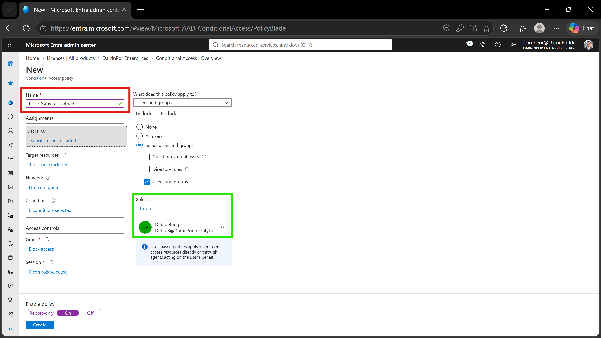
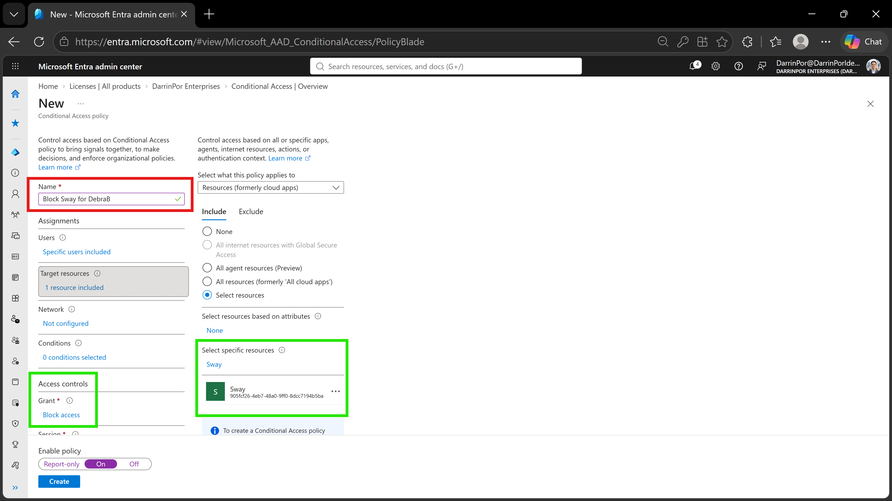
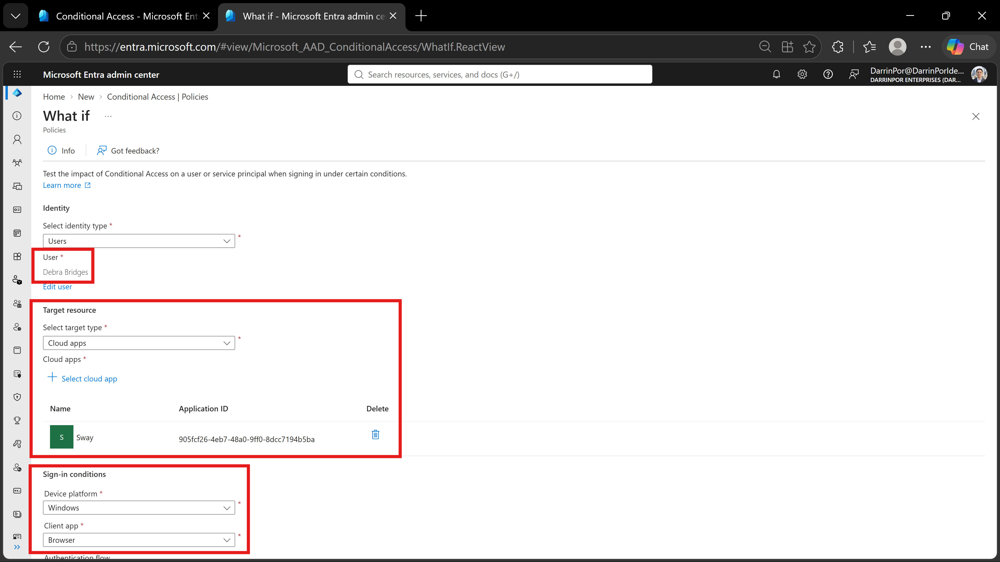
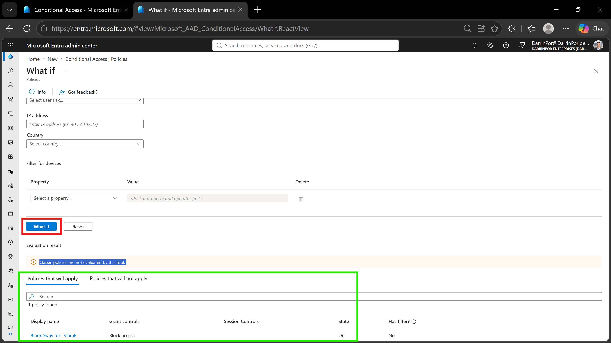
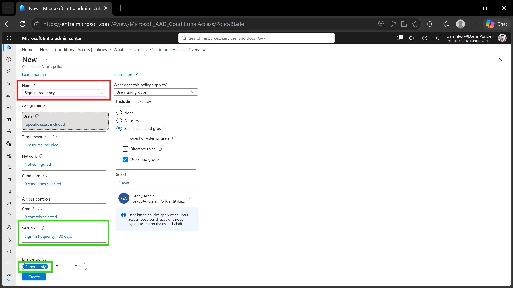

# 🛡️ Lab 13: Implement and Test a Conditional Access Policy

## 📋 1. Executive Summary & Objective
Conditional Access (CA) forms the core decision engine for Zero Trust architecture in Microsoft Entra ID. Rather than relying solely on static credentials, Conditional Access continuously evaluates contextual signals—such as user identity, targeted application, device platform, and client application—before granting or blocking access to enterprise resources. The objective of this lab is to author, deploy, and evaluate granular Conditional Access policies to restrict unapproved cloud app usage and enforce session re-authentication requirements.

In this scenario, Conditional Access policies were configured and verified using the audit-compliant Microsoft Entra ID **What If** simulation engine:
1. **Policy Creation & SaaS Blocking:** Configured the `Block Sway for DebraB` policy targeting the Sway application for user `Debra Bridges`, enforcing an active **Block access** grant control.
2. **Simulation & Audit Verification:** Validated access restriction enforcement using the **What If** simulation tool across simulated endpoint telemetry (Windows OS / Browser client) without impacting production workloads or requiring active SaaS licenses.
3. **Session Frequency Control:** Built a secondary compliance policy (`Sign in frequency`) targeting user `Grady Archie` across Office 365, setting a 30-day periodic sign-in frequency requirement in **Report-only** mode for telemetry gathering.

---

## 🏗️ 2. Architecture & Control Design

```

+-------------------------------------------------------------------------------------------------+
|                                  TENANT AUTHENTICATION BOUNDARY                                 |
|                                                                                                 |
|   Directory Tenant: DarrinPor Enterprises (DarrinPorIdentityLabs.onmicrosoft.com)                 |
|   Target Identities: Debra Bridges (DebraB@...), Grady Archie (GradyA@...)                      |
+-----------------------------------+-----------------------------------------------------+-------+
|
v
+-------------------------------------------------------------------------------------------------+
|                            MICROSOFT ENTRA CONDITIONAL ACCESS ENGINE                            |
|                                                                                                 |
|   - Signal Evaluation: Identity, Target Resource, Device Platform, Client App                   |
|   - Policy 1 Scope: DebraB -> Target: Sway -> Control: Block Access (State: On)                 |
|   - Policy 2 Scope: GradyA -> Target: Office 365 -> Control: 30-Day Frequency (Report-only)    |
+-----------------------------------+-----------------------------------------------------+-------+
|
v
+-------------------------------------------------------------------------------------------------+
|                                 WHAT IF SIMULATION & ENFORCEMENT                                |
|                                                                                                 |
|   - Simulated Telemetry: Windows Endpoint / Modern Web Browser                                  |
|   - Engine Evaluation: "Block Sway for DebraB" Policy Triggered                                 |
|   - Audit Evidence: Non-disruptive, audit-compliant simulation output capture                   |
+-------------------------------------------------------------------------------------------------+

```

---

## ⚙️ 3. Step-by-Step Implementation

### Task 1: Create Conditional Access Policy to Block Sway Access
1. Signed into the Microsoft Entra admin center (`https://entra.microsoft.com`) using Global Administrator credentials.
2. In the left navigation menu, navigated to **Protection** > **Conditional Access** > **Policies**.
3. Selected **+ New policy** to initialize the policy creation blade.
4. Named the policy **`Block Sway for DebraB`**.
5. Under **Assignments** > **Users**, selected **Specific users and groups** > **Users and groups**, and included test user `Debra Bridges`.
6. Under **Target resources**, selected **Resources (formerly cloud apps)** > **Select resources**, searched for **Sway**, and selected the application.
7. Under **Access controls** > **Grant**, selected **Block access**.
8. At the bottom of the blade, set **Enable policy** to **On** and clicked **Create**.

### Task 2: Validate Policy Impact via What If Simulation Tool
1. In the **Conditional Access | Policies** blade, selected **What If** from the top command toolbar.
2. Under **Identity**, selected **User** and assigned `Debra Bridges`.
3. Under **Target resource**, selected **Cloud apps** and chose **Sway**.
4. Under **Sign-in conditions**, defined the simulated endpoint telemetry:
   - **Device platform:** Selected `Windows`.
   - **Client app:** Selected `Browser`.
5. Clicked the **What If** button to execute the policy evaluation engine.
6. Verified that `Block Sway for DebraB` populated under the **Policies that will apply** tab with **Block access** specified under Grant controls.

### Task 3: Configure Session Control for Periodic Re-authentication
1. Navigated back to **Conditional Access** > **Policies** > **+ New policy**.
2. Named the policy **`Sign in frequency`**.
3. Under **Assignments** > **Users**, included manually provisioned test user `Grady Archie`.
4. Under **Target resources**, included cloud application **Office 365**.
5. Under **Access controls** > **Session**, checked **Sign-in frequency**, set the numerical value to `30`, and selected **Days**.
6. At the bottom of the blade, set **Enable policy** to **Report-only** mode for initial policy staging and telemetry tracking.
7. Clicked **Create** to save the policy configuration.

---

## 📸 4. Verification & Audit Evidence

### 1. Policy Target Scope - User Assignment
- **File:** `lab13-01a-block-sway-user.png`
- **Path:** `screenshots/lab13-01a-block-sway-user.png`
- **Visual Focus:** Outline the policy **Name** (`Block Sway for DebraB`) in a **Red Box** and the assigned user (`Debra Bridges`) under **Users and groups** in a **Green Box**.



### 2. Policy Target Scope - Cloud Application & Grant Control
- **File:** `lab13-01b-block-sway-app.png`
- **Path:** `screenshots/lab13-01b-block-sway-app.png`
- **Visual Focus:** Outline the policy **Name** in a **Red Box**, and highlight the targeted resource (**Sway**) alongside the **Block access** grant control and **On** state toggle in a **Green Box**.



### 3. What If Tool Simulation Parameters
- **File:** `lab13-02a-what-if-inputs.png`
- **Path:** `screenshots/lab13-02a-what-if-inputs.png`
- **Visual Focus:** Outline the simulation identity (`Debra Bridges`), target cloud app (`Sway`), and sign-in conditions (`Windows` / `Browser`) in **Red Boxes**.



### 4. What If Evaluation Engine Output
- **File:** `lab13-02b-what-if-results.png`
- **Path:** `screenshots/lab13-02b-what-if-results.png`
- **Visual Focus:** Outline the **What If** action button in a **Red Box** and highlight the policy evaluation result showing `Block Sway for DebraB` under **Policies that will apply** in a **Green Box**.



### 5. Sign-in Frequency Session Policy
- **File:** `lab13-03-signin-frequency-policy.png`
- **Path:** `screenshots/lab13-03-signin-frequency-policy.png`
- **Visual Focus:** Outline the policy **Name** (`Sign in frequency`) in a **Red Box**, and highlight the assigned user (`Grady Archie`), session control (**Sign-in frequency - 30 days**), and **Report-only** toggle in **Green Boxes**.



---

## 🛡️ 5. Zero Trust & Security Analysis

| Security Control | Threat Mitigation & Risk Assessment |
| :--- | :--- |
| **Explicit Access Control (Block Grant)** | Enforces shadow IT mitigation by explicitly blocking access to unapproved or risky SaaS applications (Sway) for specific user roles. |
| **Non-Disruptive Policy Auditing (What If)** | Provides risk-free verification of complex policy logic using simulated sign-in telemetry before deploying rules to production users. |
| **Session Persistence Management** | Limits exposure windows from stolen session tokens by requiring full re-authentication every 30 days for enterprise cloud services. |
| **Staged Policy Deployment (Report-only)** | Evaluates policy impact against real-world sign-in traffic without blocking users, capturing baseline telemetry in Entra audit logs prior to full enforcement. |

---

## 🧹 6. Rollback & Cleanup

To maintain tenant configuration hygiene and remove lab-specific policies, execute the following cleanup steps:

### Portal Cleanup

1. **Delete Lab Policies:**
   - Navigate to **Entra ID** > **Protection** > **Conditional Access** > **Policies**.
   - Select `Block Sway for DebraB` and click **Delete**.
   - Select `Sign in frequency` and click **Delete**.

2. **Remove Test Identities:**
   - Navigate to **Entra ID** > **Users** > **All users**.
   - Select test user `Grady Archie` (if manually provisioned solely for this lab) and select **Delete user**.

---

## 📝 Troubleshooting Logs & Environmental Discrepancies

- **Licensing Prerequisites:** Configuring Conditional Access policies requires an active Microsoft Entra ID P1 or P2 license. While live M365 application logins were limited during testing, Entra ID P2 licensing permitted full policy authoring and What If simulation execution.
- **Mandatory Simulation Parameters in What If UI:** In current Entra admin portal revisions, running the What If simulator requires explicitly defining **Device platform** (e.g., `Windows`) and **Client app** (e.g., `Browser`) parameters alongside user and cloud application inputs for the evaluation engine to trigger.
- **Classic Policies Disclaimer:** The What If tool displays an informational banner stating *"Classic policies are not evaluated by this tool."* This notice applies exclusively to legacy Azure portal policies and does not impact modern Entra ID Conditional Access evaluation.
