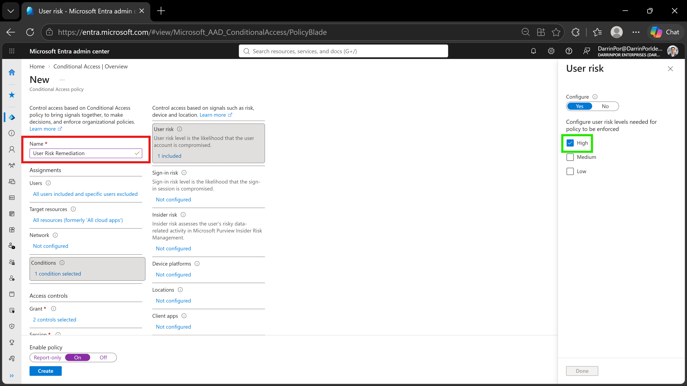
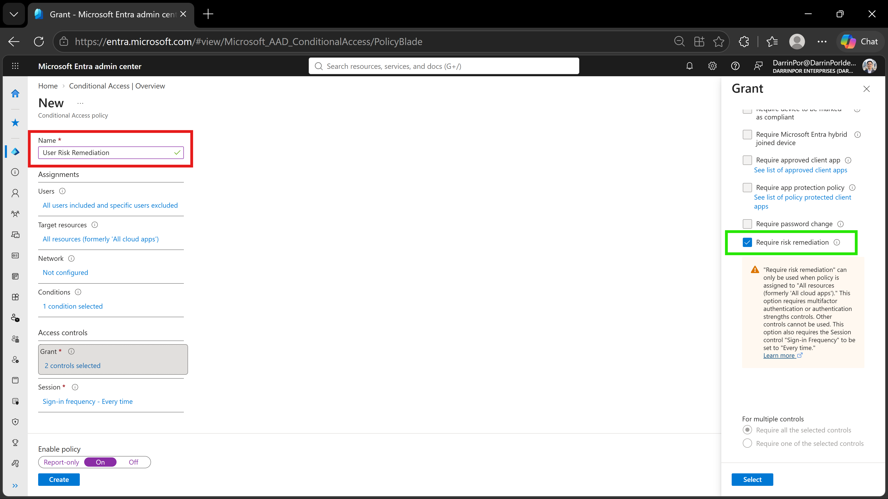
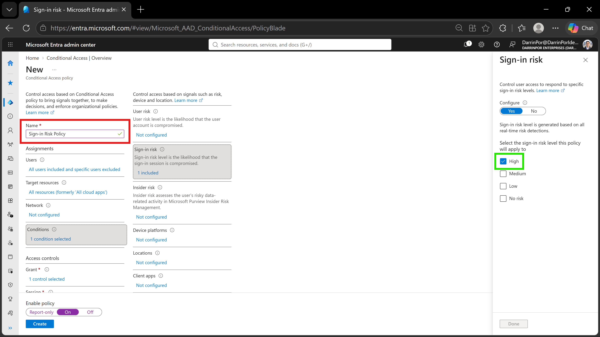
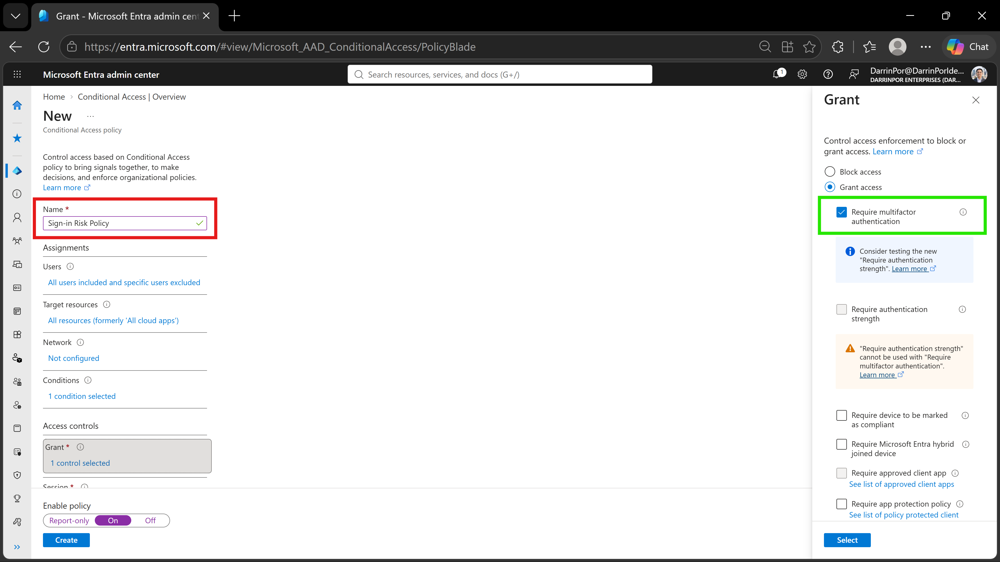

# 🛡️ Lab 14: Configure User Risk and Sign-in Risk Conditional Access Policies

## 📋 1. Executive Summary & Objective
Identity-based risk detections represent critical security telemetry within cloud environments. Microsoft Entra ID Protection continuously evaluates user behavioral baselines and real-time sign-in signals to calculate risk probability. Combining Microsoft Entra ID Protection with Conditional Access allows organizations to enforce automated risk remediation workflows, blocking compromised credentials or requiring immediate self-remediation (such as secure password reset or Multi-Factor Authentication) when risk thresholds are breached. The objective of this lab is to configure adaptive, risk-based Conditional Access policies targeting high-risk user conditions and high-risk sign-in events.

In this scenario, risk-based access policies were deployed and configured in the custom tenant:
1. **User Risk Policy Deployment:** Configured the `User Risk Remediation` policy targeting all users (excluding emergency administrative accounts), enforcing an immediate **Require risk remediation** grant control when a **High** user risk level is detected.
2. **Sign-in Risk Policy Deployment:** Configured the `Sign-in Risk Policy` targeting all users, enforcing real-time step-up authentication via **Require multifactor authentication** when a **High** sign-in risk level is detected.
3. **Emergency Exclusion Governance:** Maintained operational availability by excluding break-glass administrative accounts (`MOD Administrator`) from automated lockout or remediation mandates.

---

## 🏗️ 2. Architecture & Control Design


```

+-------------------------------------------------------------------------------------------------+
|                                  TENANT AUTHENTICATION BOUNDARY                                 |
|                                                                                                 |
|   Directory Tenant: DarrinPor Enterprises (DarrinPorIdentityLabs.onmicrosoft.com)                 |
|   Policy Scope: All Users (Excluded: Emergency Admin / MOD Administrator)                       |
+-----------------------------------+-----------------------------------------------------+-------+
|
v
+-------------------------------------------------------------------------------------------------+
|                           MICROSOFT ENTRA ID PROTECTION & RISK ENGINE                           |
|                                                                                                 |
|   - Signal Analysis: Leaked Credentials, Anonymized IP, Impossible Travel, Password Spray       |
|   - Risk Categories: User Risk (Account Compromise) & Sign-in Risk (Session Anomaly)            |
+-----------------------------------+-----------------------------------------------------+-------+
|
v
+-------------------------------------------------------------------------------------------------+
|                            CONDITIONAL ACCESS ADAPTIVE ENFORCEMENT                              |
|                                                                                                 |
|   - Policy 1 (User Risk): High Risk Level  --> Grant Control: Require Risk Remediation (On)    |
|   - Policy 2 (Sign-in Risk): High Risk Level -> Grant Control: Require MFA (On)                 |
|   - Outcome: Automated threat containment without manual administrative intervention            |
+-------------------------------------------------------------------------------------------------+

```

---

## ⚙️ 3. Step-by-Step Implementation

### Task 1: Create a User Risk Conditional Access Policy
1. Signed into the Microsoft Entra admin center (`https://entra.microsoft.com`) using Global Administrator credentials.
2. In the left navigation menu, under **Entra ID**, selected **Protection** > **Conditional Access**, then clicked **+ Create new policy**.
3. Entered **`User Risk Remediation`** in the policy **Name** field.
4. Under **Assignments** > **Users**, included **All users** on the **Include** tab.
5. Switched to the **Exclude** tab, selected **Users and groups**, and searched for and excluded **`MOD Administrator`**.
6. Under **Target resources**, selected **All resources (formerly 'All cloud apps')**.
7. Under **Conditions** > **User risk**, set **Configure** to **Yes**, selected risk level **High**, and clicked **Done**.
8. Under **Access controls** > **Grant**, selected **Grant access** and checked **Require risk remediation**.
9. Confirmed underlying session controls automatically adjusted to enforce compliance.
10. Set **Enable policy** toggle to **On** and clicked **Create** to activate the policy.

### Task 2: Create a Sign-in Risk Conditional Access Policy
1. In the **Conditional Access | Policies** blade, selected **+ Create new policy**.
2. Entered **`Sign-in Risk Policy`** in the policy **Name** field.
3. Under **Assignments** > **Users**, included **All users** on the **Include** tab.
4. Switched to the **Exclude** tab, selected **Users and groups**, and excluded **`MOD Administrator`**.
5. Under **Target resources**, selected **All resources (formerly 'All cloud apps')**.
6. Under **Conditions** > **Sign-in risk**, set **Configure** to **Yes**, selected risk level **High**, and clicked **Done**.
7. Under **Access controls** > **Grant**, selected **Grant access** and checked **Require multifactor authentication**.
8. Set **Enable policy** toggle to **On** and clicked **Create** to deploy the real-time protection policy.

---

## 📸 4. Verification & Audit Evidence

### 1. User Risk Policy - High Risk Condition
- **File:** `lab14-01a-user-risk-conditions.png`
- **Path:** `screenshots/lab14-01a-user-risk-conditions.png`
- **Visual Focus:** Outline the policy **Name** (`User Risk Remediation`) in a **Red Box** and the **User risk** condition set to **High** in a **Green Box**.



### 2. User Risk Policy - Risk Remediation Grant Control
- **File:** `lab14-01b-user-risk-grant.png`
- **Path:** `screenshots/lab14-01b-user-risk-grant.png`
- **Visual Focus:** Outline the policy **Name** in a **Red Box** and the **Require risk remediation** grant control along with the active **On** policy state toggle in a **Green Box**.



### 3. Sign-in Risk Policy - High Risk Condition
- **File:** `lab14-02a-signin-risk-conditions.png`
- **Path:** `screenshots/lab14-02a-signin-risk-conditions.png`
- **Visual Focus:** Outline the policy **Name** (`Sign-in Risk Policy`) in a **Red Box** and the **Sign-in risk** condition set to **High** in a **Green Box**.



### 4. Sign-in Risk Policy - MFA Grant Control
- **File:** `lab14-02b-signin-risk-grant.png`
- **Path:** `screenshots/lab14-02b-signin-risk-grant.png`
- **Visual Focus:** Outline the policy **Name** in a **Red Box** and the **Require multifactor authentication** grant control in a **Green Box**.



---

## 🛡️ 5. Zero Trust & Security Analysis

| Security Control | Threat Mitigation & Risk Assessment |
| :--- | :--- |
| **Automated User Risk Remediation** | Forces high-risk users (accounts flagged with leaked credentials or compromised signals) to perform self-remediation, containing identity compromise without IT helpdesk delay. |
| **Real-Time Sign-in Risk Interception** | Intercepts anomalous authentication attempts (such as password spray or impossible travel) at sign-in time by requiring immediate step-up Multi-Factor Authentication. |
| **Emergency Account Exclusion** | Protects break-glass administrative accounts (`MOD Administrator`) from automated lockout during risk events, preserving directory emergency access. |
| **Comprehensive Resource Scope** | Applies risk evaluations globally across **All cloud apps**, ensuring no unmonitored entry points exist within the directory boundary. |

---

## 🧹 6. Rollback & Cleanup

To maintain tenant configuration hygiene and remove lab-specific risk policies, execute the following cleanup steps:

### Portal Cleanup

1. **Delete Risk-Based Conditional Access Policies:**
   - Navigate to **Entra ID** > **Protection** > **Conditional Access** > **Policies**.
   - Select `User Risk Remediation` and click **Delete**.
   - Select `Sign-in Risk Policy` and click **Delete**.
2. **Verify Policy Removal:**
   - Refresh the policy table to ensure no orphaned risk rules remain active in the tenant.

---

## 📝 Troubleshooting Logs & Environmental Discrepancies

- **Licensing Prerequisites:** Configuring user risk and sign-in risk conditions within Conditional Access requires active Microsoft Entra ID P2 licensing across evaluated accounts. Premium P2 capabilities enable real-time risk signal processing and adaptive grant controls.
- **Automated Control Dependencies:** Selecting **Require risk remediation** within a user risk policy automatically mandates underlying MFA and sets session sign-in frequency to "Every time". This portal behavior aligns with Microsoft's enforcement baseline for high-risk identity containment.
- **Break-Glass Exclusion Baseline:** Enterprise security best practice dictates excluding break-glass accounts from automated risk policies to prevent tenant lockout during widespread identity risk events or false-positive triggers.
