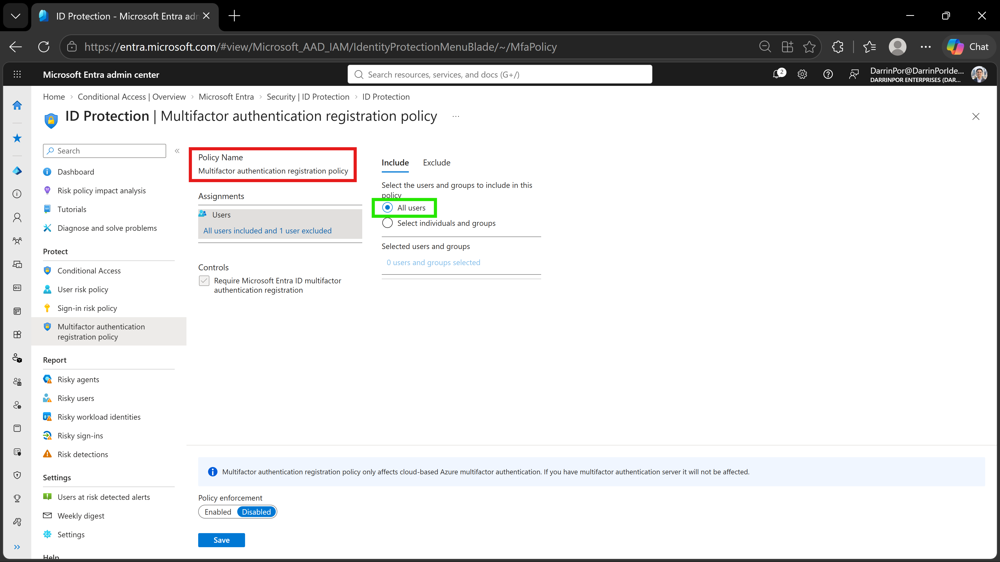
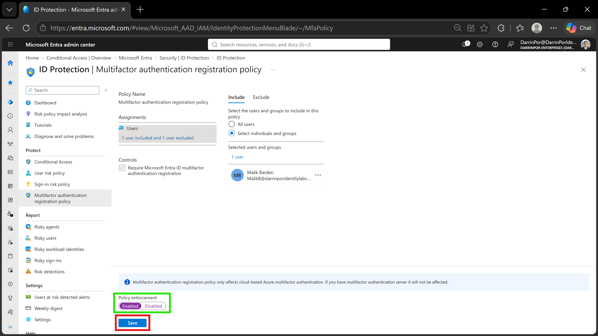

# 🛡️ Lab 15: Configure a Multifactor Authentication Registration Policy

## 📋 1. Executive Summary & Objective
Multifactor authentication (MFA) provides a second layer of security to user sign-ins by verifying identity using more than just a username and password. For users to be able to respond to MFA prompts, they must first register for Microsoft Entra Multifactor Authentication. The objective of this lab is to configure and enforce the Microsoft Entra ID Protection MFA registration policy to ensure enterprise users complete security registration before risky activity or unverified sign-in access can occur.

In this scenario, the MFA registration policy was configured and verified within the custom tenant:
1. **Policy Navigation & Review:** Accessed the **Multifactor authentication registration policy** blade via Microsoft Entra ID Protection to evaluate default user assignments and mandatory registration controls.
2. **Policy Enforcement Tuning:** Configured targeted user rollout assignments (such as pilot user `Malik Barden`) and switched **Policy enforcement** from disabled to **Enabled**.
3. **State Persistence & Audit Validation:** Committed configuration updates via the administrative save action to require mandatory MFA registration upon subsequent user authentication attempts.

---

## 🏗️ 2. Architecture & Control Design


```

+-------------------------------------------------------------------------------------------------+
|                                  TENANT AUTHENTICATION BOUNDARY                                 |
|                                                                                                 |
|   Directory Tenant: DarrinPor Enterprises (DarrinPorIdentityLabs.onmicrosoft.com)                 |
|   Prerequisite Licensing: Microsoft Entra ID Premium P2 (Required for ID Protection)            |
+-----------------------------------+-----------------------------------------------------+-------+
|
v
+-------------------------------------------------------------------------------------------------+
|                             MICROSOFT ENTRA ID PROTECTION & SECURITY                            |
|                                                                                                 |
|   - Policy Blade: Multifactor Authentication Registration Policy                                |
|   - Default Scope: All Users (Flexible individual or group exclusions/inclusions supported)     |
|   - Mandatory Control: Require Microsoft Entra ID Multifactor Authentication Registration       |
+-----------------------------------+-----------------------------------------------------+-------+
|
v
+-------------------------------------------------------------------------------------------------+
|                                 ENFORCEMENT & USER REMEDIATION                                  |
|                                                                                                 |
|   - Policy Enforcement State: Enabled                                                           |
|   - Sign-in Interception: Mandatory security information prompt on next authentication attempt  |
|   - Audit Evidence: Verified administrative save confirmation & targeted pilot scope validation |
+-------------------------------------------------------------------------------------------------+

```

---

## ⚙️ 3. Step-by-Step Implementation

### Task 1: Access and Review the MFA Registration Policy
1. Signed into the Microsoft Entra admin center (`https://entra.microsoft.com`) using Global Administrator credentials.
2. In the left navigation menu, under **Entra ID**, navigated to **Identity Protection** > **Multifactor authentication registration policy** (located under the Protect menu).
3. Under **Assignments** > **Users**, reviewed the default inclusion scope set to **All users** alongside supported individual or group customization options.
4. Verified under **Controls** that the mandatory requirement **Require Microsoft Entra ID multifactor authentication registration** is permanently selected and enforced by the engine.

### Task 2: Configure and Enable Identity Protection MFA Registration Policy
1. Expanded **ID Protection** and selected **Dashboard**, then navigated to **Multifactor authentication registration policy** under Protect.
2. Under **Assignments**, selected users (such as configuring individual scope for pilot user `Malik Barden`) to enforce registration parameters.
3. Located the **Policy enforcement** field at the bottom of the configuration pane and switched its value from **Disabled** to **Enabled**.
4. Clicked **Save** to commit the policy configuration to the tenant directory.
5. Validated that subsequent sign-in attempts from private browser sessions prompt users to supply mandatory security information for MFA setup.

---

## 📸 4. Verification & Audit Evidence

### 1. MFA Registration Policy Assignment Scope
- **File:** `lab15-01-mfa-registration-assignment.jpg`
- **Path:** `screenshots/lab15-01-mfa-registration-assignment.jpg`
- **Visual Focus:** Outline the policy title (`Multifactor authentication registration policy`) in a **Red Box** and highlight the assignment scope (`All users`) on the Include tab in a **Green Box**.



### 2. Policy Enforcement & Save Action
- **File:** `lab15-02-mfa-registration-enforced.jpg`
- **Path:** `screenshots/lab15-02-mfa-registration-enforced.jpg`
- **Visual Focus:** Outline the targeted user scope (`Malik Barden`), highlight the **Policy enforcement** toggle set to **Enabled** in a **Green Box**, and outline the **Save** action button in a **Red Box**.



---

## 🛡️ 5. Zero Trust & Security Analysis

| Security Control | Threat Mitigation & Risk Assessment |
| :--- | :--- |
| **Proactive Credential Protection** | Eliminates unverified single-factor authentication gaps by mandating MFA registration before users access core cloud workloads. |
| **Adaptive Identity Protection** | Integrates directly with Microsoft Entra ID Protection intelligence to assess risk posture during onboarding and authentication. |
| **Staged Rollout & Pilot Flexibility** | Permits administrative scoping (such as targeting specific pilot groups or individual accounts like `Malik Barden`) before broad enterprise-wide enforcement. |
| **Mandatory Registration Controls** | Enforces core compliance baselines by locking the underlying security registration requirement against unauthorized administrative tampering. |

---

## 🧹 6. Rollback & Cleanup

To maintain tenant configuration hygiene and remove lab-specific policies, execute the following cleanup steps:

### Portal Cleanup

1. **Revert MFA Registration Policy Enforcement:**
   - Navigate to **Entra ID** > **Identity Protection** > **Multifactor authentication registration policy**.
   - Set **Policy enforcement** back to **Disabled** if returning the tenant to baseline state, or adjust user assignment scopes back to organization defaults.
   - Click **Save** to commit configuration updates.

---

## 📝 Troubleshooting Logs & Environmental Discrepancies

- **Licensing Prerequisites:** Configuring Microsoft Entra ID Protection policies requires an active **Microsoft Entra ID Premium P2** license tier within the tenant directory. Standard P1 or free licensing does not support automated risk or identity protection registration enforcement rules.
- **Immutable Registration Controls:** The core grant requirement (*Require Microsoft Entra ID multifactor authentication registration*) is a system-managed baseline control that cannot be unchecked or disabled within the policy configuration blade.
- **Browser Session Isolation:** When testing user registration prompts via `https://login.microsoftonline.com`, always utilize private or incognito browsing sessions to prevent cached authentication cookies from bypassing the newly triggered security information prompt.
