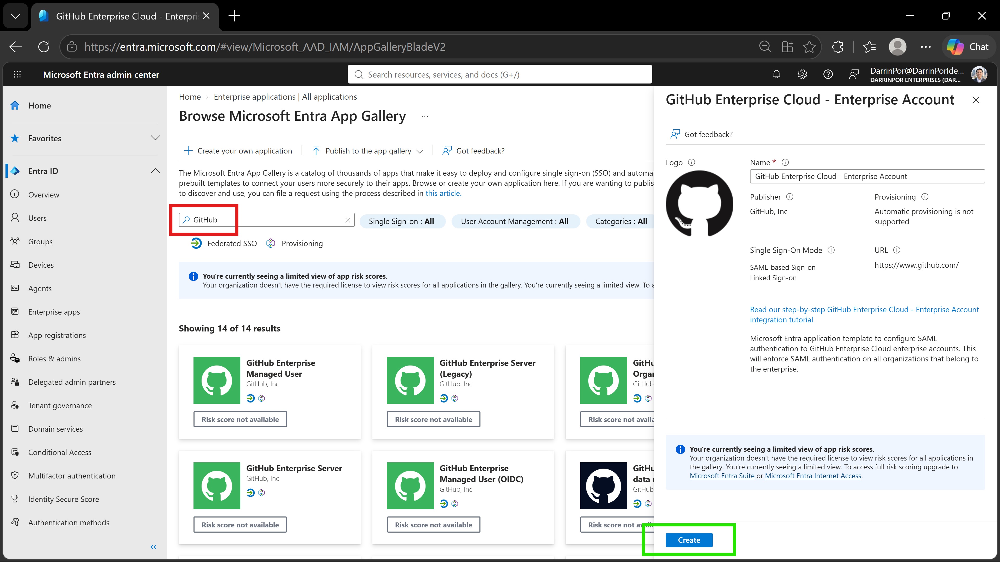
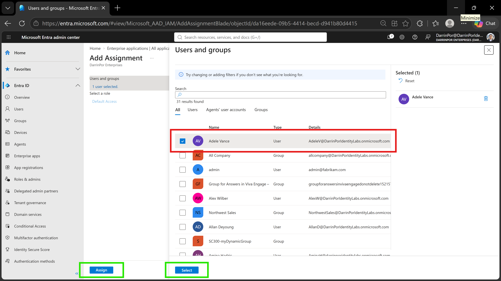
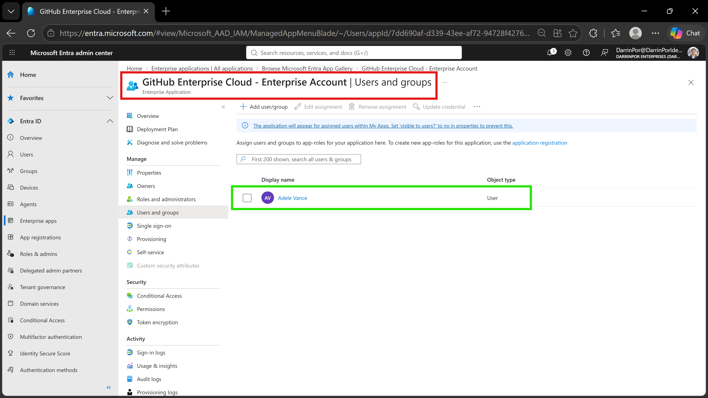

# 🛡️ Lab 20: Implement Access Management for Apps

## 📋 1. Executive Summary & Objective
By default, enterprise applications in Microsoft Entra ID may allow all users in the directory to sign in unless explicit user assignment is enforced. Restricting application access to designated personnel is critical for maintaining least-privilege governance and mitigating unauthorized access risks in cloud environments. The objective of this lab is to provision a federated enterprise application (*GitHub Enterprise Cloud - Enterprise Account*) from the Microsoft Entra gallery and configure explicit user and group assignment controls to govern who can access the application.

In this scenario, enterprise application access management was configured and verified within the tenant:
1. **Enterprise App Provisioning:** Deployed `GitHub Enterprise Cloud - Enterprise Account` from the Microsoft Entra gallery into the tenant.
2. **Access Control Enforcement:** Configured explicit user assignment requirements to restrict application access exclusively to designated accounts (`Adele Vance` and the `MOD Administrator`).
3. **Governance & Audit Verification:** Verified assignment persistence to ensure non-assigned tenant users are blocked from accessing the enterprise application context.

---

## 🏗️ 2. Architecture & Control Design

```text
+-------------------------------------------------------------------------------------------------+
|                                  TENANT SECURITY BOUNDARY                                       |
|                                                                                                 |
|    Directory Tenant: DarrinPor Enterprises (DarrinPorIdentityLabs.onmicrosoft.com)              |
|    Prerequisite Licensing: Microsoft Entra ID P2 / E5 Tenant                                    |
+-----------------------------------+-----------------------------------------------------+-------+
                                    |
                                    v
+-------------------------------------------------------------------------------------------------+
|                         MICROSOFT ENTRA ID & ENTERPRISE APPLICATIONS                            |
|                                                                                                 |
|    - Target Application: GitHub Enterprise Cloud - Enterprise Account                           |
|    - Application Type: Federated Enterprise Application (Gallery Deployment)                    |
|    - Access Control Model: User Assignment Required (Explicit Authorization)                    |
|    - Authorized Principals: Adele Vance & MOD Administrator account                             |
+-----------------------------------+-----------------------------------------------------+-------+
                                    |
                                    v
+-------------------------------------------------------------------------------------------------+
|                                  ACCESS GOVERNANCE & ENFORCEMENT                                |
|                                                                                                 |
|    - Assignment Scope: Restricted tenant-wide access to targeted test accounts only             |
|    - Authorization Boundary: Non-assigned directory users are blocked from sign-in              |
|    - Audit Validation: Users and groups management blade verifies explicit role mappings        |
+-------------------------------------------------------------------------------------------------+

```
---

## ⚙️ 3. Step-by-Step Implementation

### Task 1: Add an App to Your Microsoft Entra Tenant

1. Signed in to the **Microsoft Entra admin center** at `https://entra.microsoft.com` using a Global Administrator account, completing Multi-Factor Authentication (MFA) prompts as required.


2. In the left navigation menu, under *Entra ID*, selected **Enterprise apps**.


3. On the **Enterprise applications** page, selected **+ New application**.


4. On the **Browse Microsoft Entra Gallery** page, entered `GitHub` in the search application box.


5. In the search results, selected **GitHub Enterprise Cloud - Enterprise Account**.


6. Reviewed the settings within the application overview pane and selected **Create** to provision the application into the tenant, redirecting to the management overview page.


### Task 2: Assign Users to an App

1. On the **GitHub Enterprise Cloud - Enterprise Account** overview page, under *Getting Started*, selected **1. Assign users and groups** (alternatively, navigated via the left navigation menu under *Manage* to select **Users and groups**).


2. On the **Users and groups** page, selected **+ Add user/group** from the top menu.


3. On the **Add Assignment** page, selected **None selected** in the *Users and groups* section.


4. In the **Users and groups** selection pane, selected **Adele Vance** and your **MOD administrator account**.


5. Selected **Select** at the bottom of the pane.


6. Selected **Assign** to finalize the user assignment and enforce access restrictions.


---

## 📸 4. Verification & Audit Evidence

### 1. Enterprise App Gallery Selection
- **File:** `lab20-01-enterprise-app-gallery-selection.png`
- **Path:** `labs/Domain-3-Identity-Protection/Lab-20-Implement-access-management-for-apps/screenshots/lab20-01-enterprise-app-gallery-selection.png`
- **Visual Focus:** Outline the **GitHub** search filter input in a **Red Box** and highlight the **Create** button for *GitHub Enterprise Cloud - Enterprise Account* in a **Green Box**.



### 2. Add Assignment User Selection
- **File:** `lab20-02-add-assignment-user-selection.png`
- **Path:** `labs/Domain-3-Identity-Protection/Lab-20-Implement-access-management-for-apps/screenshots/lab20-02-add-assignment-user-selection.png`
- **Visual Focus:** Outline the target assigned user account (**Adele Vance**) row in a **Red Box** and highlight the **Assign** and **Select** buttons in a **Green Box**.



### 3. Assigned Users and Groups Overview
- **File:** `lab20-03-assigned-users-and-groups.png`
- **Path:** `labs/Domain-3-Identity-Protection/Lab-20-Implement-access-management-for-apps/screenshots/lab20-03-assigned-users-and-groups.png`
- **Visual Focus:** Outline the **GitHub Enterprise Cloud - Enterprise Account | Users and groups** header blade in a **Red Box** and highlight the verified assigned user row (**Adele Vance**) in a **Green Box**.



---

## 🛡️ 5. Zero Trust & Security Analysis

| Security Control | Threat Mitigation & Risk Assessment |
| --- | --- |
| **Default Tenant Assignment Exposure** | Implicitly allows all tenant users to authenticate into newly added SaaS applications unless restricted, creating potential shadow IT and unauthorized data access vectors.
| **Explicit User Assignment Control** | Enforces least privilege by binding enterprise app access strictly to designated individuals (`Adele Vance` and the `MOD Administrator`), preventing unauthorized lateral movement.
| **Federated Identity Governance** | Maintains centralized administrative control over third-party SaaS integrations at the Microsoft Entra identity provider level rather than relying on decentralized local application accounts.

 
| **Audit & Compliance Verification** | Provides verifiable proof of access restrictions via Entra audit logs and explicit group/user assignments for regulatory compliance and access review audits.


---

## 🧹 6. Rollback & Cleanup

To maintain tenant configuration hygiene and remove lab-specific application objects, execute the following cleanup steps:

### Portal Cleanup

1. **Delete Enterprise Application Registration:**
* Navigate to the **Microsoft Entra admin center** (`https://entra.microsoft.com`) > **Enterprise apps** > **All applications**.


* Locate and select **GitHub Enterprise Cloud - Enterprise Account**.
* Navigate to the application's **Properties** blade and click **Delete**, then confirm to remove the enterprise application object and associated service principal from the directory.


---

## 📝 Troubleshooting Logs & Environmental Discrepancies

* **Assignment Propagation Delay:** Newly configured user and group assignments for enterprise applications can occasionally experience a 1-to-2 minute replication delay before conditional sign-in enforcement blocks non-assigned accounts.
* **Gallery App Identifier Uniqueness:** When provisioning gallery applications, ensure enterprise naming matches standard tenant naming conventions to avoid administrative confusion during access reviews.
