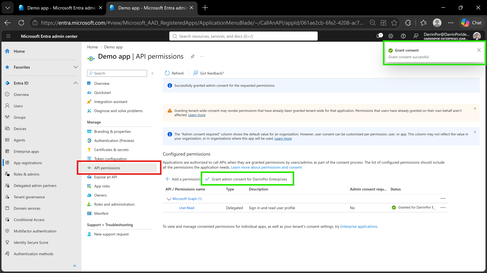
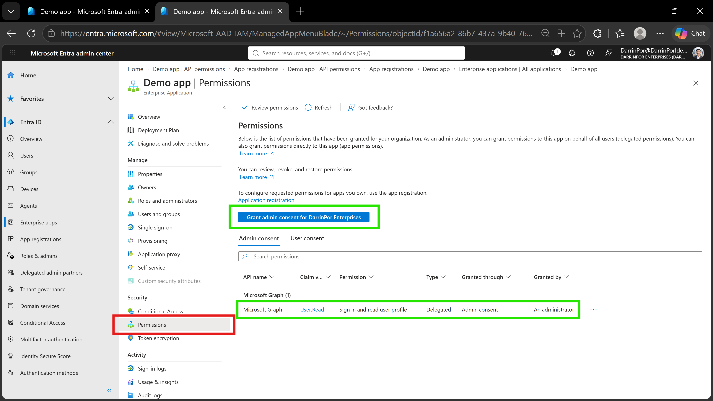

# 🛡️ Lab 21: Grant Tenant-Wide Admin Consent to an Application

## 📋 1. Executive Summary & Objective
Granting tenant-wide admin consent to an application pre-approves application permissions on behalf of all users in the organization. This eliminates the need for individual end users to review and consent to permissions when interacting with enterprise software, while centralizing security governance under Global Administrator control. The objective of this lab is to configure and grant tenant-wide administrative consent for an application (*Demo app*) using both **App Registrations** and **Enterprise Applications** management blades within Microsoft Entra ID.

In this scenario, tenant-wide consent management was executed and verified within the custom tenant:
1. **App Registrations Administrative Consent:** Navigated to the registered application object (*Demo app*) and granted tenant-wide consent for configured Microsoft Graph API permissions (`User.Read`).
2. **Enterprise Applications Consent Management:** Located the provisioned service principal in *Enterprise Applications* and verified/granted admin consent directly at the enterprise service principal level.
3. **Governance & Audit Lineage:** Established verifiable proof that administrative pre-approval overrides individual user prompts and centralizes application data access controls.

---

## 🏗️ 2. Architecture & Control Design

```text
+-------------------------------------------------------------------------------------------------+
|                                  TENANT SECURITY BOUNDARY                                       |
|                                                                                                 |
|    Directory Tenant: DarrinPor Enterprises (DarrinPorIdentityLabs.onmicrosoft.com)              |
|    Prerequisite Licensing: Microsoft Entra ID P2 / E5 Tenant                                    |
|    Required Administrative Role: Global Administrator                                           |
+-----------------------------------+-----------------------------------------------------+-------+
                                    |
                                    v
+-------------------------------------------------------------------------------------------------+
|                            MICROSOFT ENTRA ID & APP REGISTRATIONS                               |
|                                                                                                 |
|    - Target Application: Demo app                                                               |
|    - App Identifiers: Application (client) ID & Directory (tenant) ID captured                  |
|    - Configured Permissions: Microsoft Graph API (User.Read - Delegated Permission)             |
|    - Consent Scope: Tenant-wide admin consent granted via App Registrations blade               |
+-----------------------------------+-----------------------------------------------------+-------+
                                    |
                                    v
+-------------------------------------------------------------------------------------------------+
|                           ENTERPRISE APPLICATIONS CONSENT LAYER                                 |
|                                                                                                 |
|    - Service Principal Context: Enterprise Applications -> Demo app -> Security -> Permissions   |
|    - Execution Model: Tenant-wide consent granted/verified across enterprise service principal   |
|    - Governance Boundary: End-user consent prompts bypassed via pre-approved admin consent     |
+-------------------------------------------------------------------------------------------------+

```

---

## ⚙️ 3. Step-by-Step Implementation

### Task 1: Grant Admin Consent in App Registrations

1. Signed in to the **Microsoft Entra admin center** at `https://entra.microsoft.com` using a Global Administrator account, completing Multi-Factor Authentication (MFA) prompts as required.


2. In the left navigation menu under *Entra ID*, navigated to **App registrations**, selected the **All applications** tab, and chose **Demo app**.


3. On the **Demo app** overview blade, located the **Application (client) ID** and **Directory (tenant) ID** values as directed by the lab instructions (noting that while captured per baseline requirements, these identifier values were not actively required or utilized for this specific consent execution).


4. In the left navigation menu under *Manage*, selected **API permissions**.


5. Under *Configured permissions*, selected **Grant admin consent for DarrinPor Enterprises**.


6. Reviewed the confirmation dialogue box and selected **Yes** to complete the tenant-wide consent grant.


### Task 2: Grant Admin Consent in Enterprise Apps

1. In the **Microsoft Entra admin center** left navigation menu under *Entra ID*, selected **Enterprise apps**.


2. From the *All applications* list, selected **Demo app**.


3. On the **Demo app** management page under *Security*, selected **Permissions**.


4. Under the *Permissions* management pane, selected **Grant admin consent for DarrinPor Enterprises**.


5. Prompted by the authentication flow, re-authenticated using the **Global Administrator** account.


6. On the **Permissions requested** consent prompt, thoroughly reviewed the requested scope details and selected **Accept** to finalize enterprise-level consent.


---

## 📸 4. Verification & Audit Evidence

### 1. App Registrations API Permissions & Consent
- **File:** `lab21-01-app-registrations-api-permissions.png`
- **Path:** `labs/Domain-3-Identity-Protection/Lab-21-Grant-tenant-wide-admin-consent-to-an-application/screenshots/lab21-01-app-registrations-api-permissions.png`
- **Visual Focus:** Outline the **API permissions** item under *Manage* in a **Red Box** and highlight the **Grant admin consent for DarrinPor Enterprises** button along with the success banner (*"Successfully granted admin consent for the requested permissions."*) in a **Green Box**.



### 2. Enterprise Applications Permissions & Consent
- **File:** `lab21-02-enterprise-apps-permissions-consent.png`
- **Path:** `labs/Domain-3-Identity-Protection/Lab-21-Grant-tenant-wide-admin-consent-to-an-application/screenshots/lab21-02-enterprise-apps-permissions-consent.png`
- **Visual Focus:** Outline the **Permissions** link under *Security* in a **Red Box** and highlight the **Grant admin consent for DarrinPor Enterprises** option and the *Admin consent* status table in a **Green Box**.



---

## 🛡️ 5. Zero Trust & Security Analysis

| Security Control | Threat Mitigation & Risk Assessment |
| --- | --- |
| **Centralized Consent Governance** | Prevents illicit consent grant attacks and phishing exploits by restricting application permission grants exclusively to Global Administrators.

 
| **Explicit Scope Review** | Mitigates broad data leakage risks by requiring explicit administrative review of requested API scopes prior to approving tenant-wide authorization.

 
| **Revocation Impact Awareness** | Granting tenant-wide consent through App Registrations revokes any previously granted tenant-wide consent states for that app, ensuring clean configuration baselines.

 
| **Dual-Layer Verification (App vs. SP)** | Validates permission inheritance across both the application registration object and the enterprise service principal instance.

 

---

## 🧹 6. Rollback & Cleanup

To maintain tenant configuration hygiene and restore original consent states, execute the following cleanup steps:

### Portal Cleanup

1. **Revoke Tenant-Wide Admin Consent:**
* Navigate to **Microsoft Entra admin center** (`https://entra.microsoft.com`) > **Enterprise apps** > **Demo app** > **Permissions**.


* Locate the consented permissions, click the context menu (`...`), and select **Revoke consent** to restore default consent behavior.


2. **Remove Demo Application Object (Optional):**
* If lab testing is complete, navigate to **App registrations** > **Demo app** and select **Delete** to purge the application object and corresponding service principal from the directory.


---

## 📝 Troubleshooting Logs & Environmental Discrepancies

* **Consent Propagation Delays:** Tenant-wide consent state updates can take up to 2 minutes to propagate across Microsoft Entra authentication endpoints before end users stop receiving consent prompts.
* **Role Elevation Requirement:** Admin consent actions require the Global Administrator role (or privileged role combinations such as Application Administrator + Privileged Role Administrator for specific scopes).
