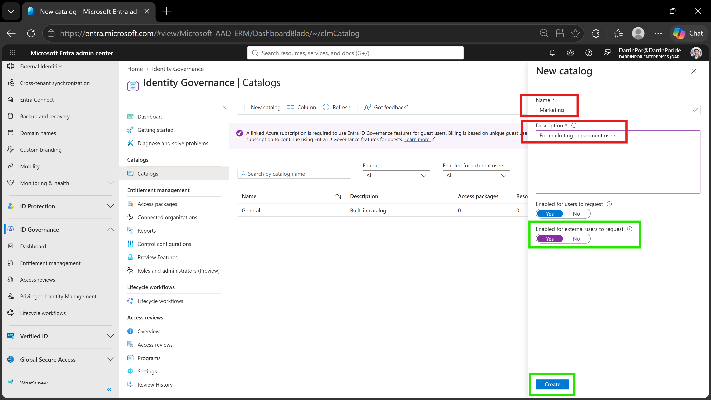
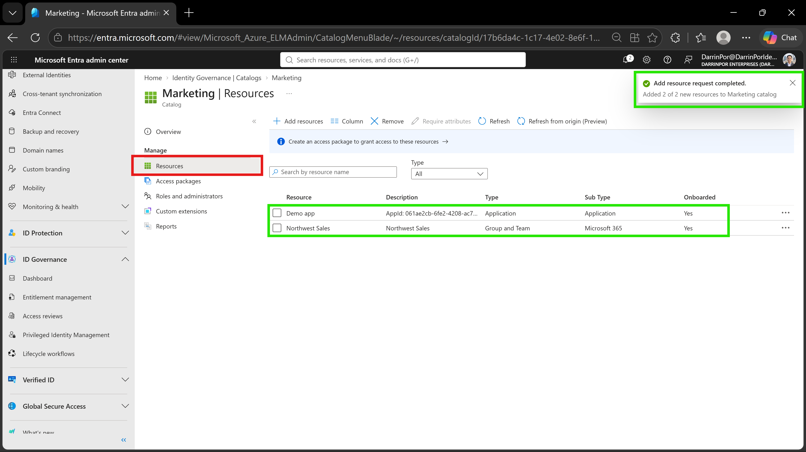
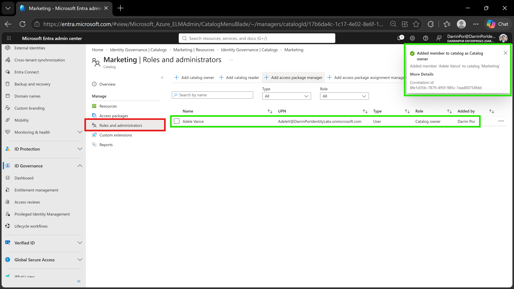
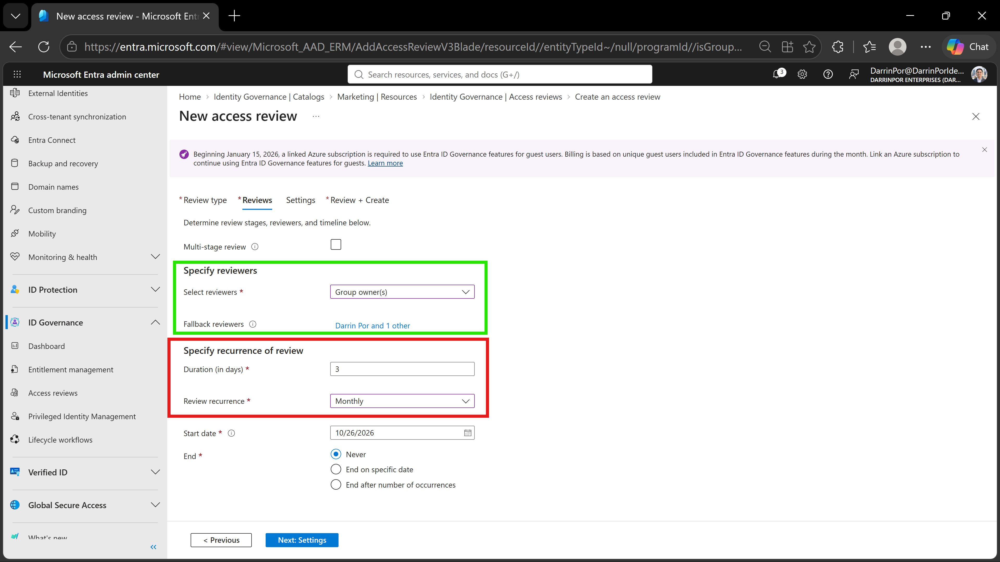

# 🛡️ Lab 22: Create and Manage a Catalog of Resources in Microsoft Entra Entitlement Management

## 📋 1. Executive Summary & Objective
Microsoft Entra entitlement management allows organizations to manage access to groups, applications, and SharePoint sites through access packages and logical containers called **catalogs**. A catalog acts as a security and administrative boundary that groups related resources, enabling decentralized ownership and delegated management while maintaining strict organizational governance. 

The objective of this lab is to create and configure a catalog (`Marketing`), add selected enterprise resources (*Demo app* and *Northwest Sales* group), delegate management responsibilities to secondary owners (*Adele Vance*), and establish automated identity governance controls via guest access reviews.

In this scenario, entitlement management and governance controls were executed and verified within the custom tenant:
1. **Catalog Provisioning:** Created and enabled the *Marketing* catalog for internal user resource packaging.
2. **Resource Association:** Populated the catalog with applications and security groups to build out access packages.
3. **Delegated Administration:** Assigned secondary catalog ownership to distribute administrative overhead.
4. **Lifecycle Governance:** Configured automated monthly access reviews for guest users with fallback administrative review safeguards.

---

## 🏗️ 2. Architecture & Control Design

```text
+-------------------------------------------------------------------------------------------------+
|                                  TENANT GOVERNANCE BOUNDARY                                     |
|                                                                                                 |
|    Directory Tenant: DarrinPor Enterprises (DarrinPorIdentityLabs.onmicrosoft.com)              |
|    Prerequisite Licensing: Microsoft Entra ID Governance / P2 Tenant                            |
|    Required Administrative Role: Global Administrator                                           |
+-----------------------------------+-----------------------------------------------------+-------+
                                    |
                                    v
+-------------------------------------------------------------------------------------------------+
|                         MICROSOFT ENTRA ID ENTITLEMENT MANAGEMENT                               |
|                                                                                                 |
|    - Catalog Name: Marketing                                                                    |
|    - Description: For marketing department users                                                |
|    - Catalog Owner: Darrin Por (Primary) & Adele Vance (Delegated Owner Role)                   |
+-----------------------------------+-----------------------------------------------------+-------+
                                    |
        +---------------------------+---------------------------+
        |                                                       |
        v                                                       v
+----------------------------------+   +--------------------------------------------------+
|      CATALOG RESOURCES           |   |           IDENTITY GOVERNANCE AUDIT              |
|                                  |   |                                                  |
|  - Application: Demo app         |   |  - Review Scope: Teams + Groups (Guest Users)    |
|  - Group/Team: Northwest Sales   |   |  - Recurrence: Monthly (3-Day Duration)          |
|                                  |   |  - Fallback Reviewers: Darrin Por & Adele Vance  |
+----------------------------------+   +--------------------------------------------------+

```

---

## ⚙️ 3. Step-by-Step Implementation

### Task 1: Create a Catalog

1. Signed in to the **Microsoft Entra admin center** at `https://entra.microsoft.com` using a Global Administrator account.


2. In the left navigation menu, expanded **ID Governance** and selected **Entitlement management**.


3. Under *Catalogs*, selected **Catalogs** and clicked **+ New catalog** on the top menu.


4. Configured catalog settings:
* **Name:** `Marketing`


* **Description:** `For marketing department users`


* **Enabled:** Set to **Yes**


* **Enabled for external users:** Set to **No** (restricted to internal tenant users for initial staging)


5. Selected **Create** to instantiate the catalog.


### Task 2: Add Resources to a Catalog

1. Navigated to **ID Governance** > **Entitlement management** > **Catalogs** and selected the **Marketing** catalog.


2. In the left navigation menu under *Manage*, selected **Resources**.


3. Selected **+ Add resources** and chose available tenant assets:
* **Groups and Teams:** Added the `Northwest Sales` Microsoft 365 security group.


* **Applications:** Added the registered enterprise application `Demo app`.


4. Verified resource linkage and selected **Add** to commit resources to the catalog contents.


### Task 3: Add Additional Catalog Owners

1. Within the **Marketing** catalog management pane, selected **Roles and administrators** under *Manage*.


2. Selected **+ Add catalog owner** from the top menu.


3. Searched for and selected user **Adele Vance**, then confirmed the selection to delegate catalog management responsibilities.


4. Verified that *Adele Vance* appeared in the role assignment table with the *Catalog owner* role.


### Task 4 & 5: Configure Guest Access Reviews

1. Expanded **ID Governance** in the Entra admin center and selected **Access reviews**.


2. Selected **+ New access review** and configured guest governance parameters:


* **Resource review / Scope:** Targeted Teams + Groups scoped to all Microsoft 365 groups with guest users, filtering for **Guest users only**.


* **Reviewers:** Configured **Group owner(s)** as primary reviewers with designated fallback reviewers (*Darrin Por* and *Adele Vance*).


* **Recurrence & Duration:** Set review duration to **3 days** with a **Monthly** review recurrence.


* **Review Behavior:** Enabled **Auto apply results to resource** and configured non-responders to **Remove access**.


3. Completed validation and selected **Create**.


---

## 📸 4. Verification & Audit Evidence

### 1. Catalog Creation & Properties
- **File:** `lab22-01-catalog-creation.png`
- **Path:** `labs/Domain-4-Identity-Sync-And-Security/Lab-22-Create-and-manage-a-catalog-of-resources-in-Microsoft-Entra-entitlement-management/screenshots/lab22-01-catalog-creation.png`
- **Visual Focus:** Outline the **Name** (`Marketing`) and **Description** fields in a **Red Box**; highlight the **Enabled** toggle (*Yes*) and **Create** button in a **Green Box**.



### 2. Add Resources to Catalog
- **File:** `lab22-02-add-resources-to-catalog.png`
- **Path:** `labs/Domain-4-Identity-Sync-And-Security/Lab-22-Create-and-manage-a-catalog-of-resources-in-Microsoft-Entra-entitlement-management/screenshots/lab22-02-add-resources-to-catalog.png`
- **Visual Focus:** Outline the **Resources** menu option under *Manage* in a **Red Box**; highlight the success notification banner and table rows showing **Demo app** and **Northwest Sales** in a **Green Box**.



### 3. Catalog Roles and Administrators
- **File:** `lab22-03-catalog-roles-and-administrators.png`
- **Path:** `labs/Domain-4-Identity-Sync-And-Security/Lab-22-Create-and-manage-a-catalog-of-resources-in-Microsoft-Entra-entitlement-management/screenshots/lab22-03-catalog-roles-and-administrators.png`
- **Visual Focus:** Outline the **Roles and administrators** menu link in a **Red Box**; highlight the success notification and the table entry showing **Adele Vance** assigned as *Catalog owner* in a **Green Box**.



### 4. Guest Access Review Configuration
- **File:** `lab22-04-access-review-configuration.png`
- **Path:** `labs/Domain-4-Identity-Sync-And-Security/Lab-22-Create-and-manage-a-catalog-of-resources-in-Microsoft-Entra-entitlement-management/screenshots/lab22-04-access-review-configuration.png`
- **Visual Focus:** Outline the 3-day duration and **Monthly** recurrence settings in a **Red Box**; highlight the primary reviewer configuration and fallback reviewers in a **Green Box**.



---

## 🛡️ 5. Zero Trust & Security Analysis

| Security Control | Threat Mitigation & Risk Assessment |
| --- | --- |
| **Catalog-Based Segregation** | Enforces least privilege separation by grouping disparate resources into domain-specific containers, preventing administrative privilege over-assignment.


| **Delegated Ownership Governance** | Distributes administrative tasks to business unit owners (e.g., Adele Vance) without granting tenant-wide Global Administrator permissions.

 
| **Automated Guest Access Reviews** | Mitigates stale guest permissions and unauthorized credential sprawl through recurring identity attestation and automated removal.

 
| **Fallback Reviewer Safeguards** | Prevents compliance bottlenecks during unattended primary reviews by routing unacknowledged audit requests to designated fallback administrators.


---

## 🧹 6. Rollback & Cleanup

To maintain tenant hygiene and preserve test infrastructure states:

1. **Retain Catalog for Subsequent Labs:** Note that the *Marketing* catalog and assigned resources are preserved to support downstream access package configuration labs.


2. **Access Review Inspection:** Periodic reviews can be monitored via **ID Governance** > **Access reviews** to verify lifecycle state tracking.
