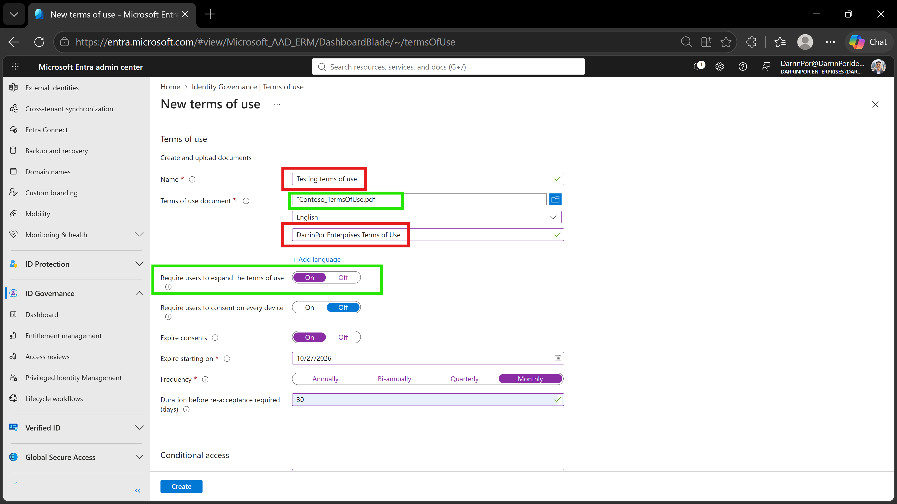
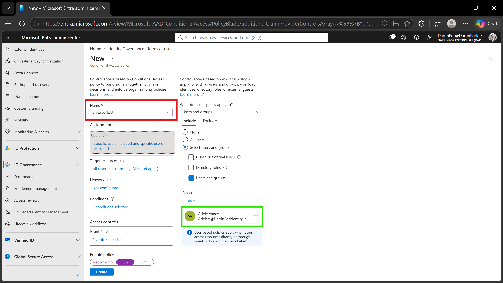
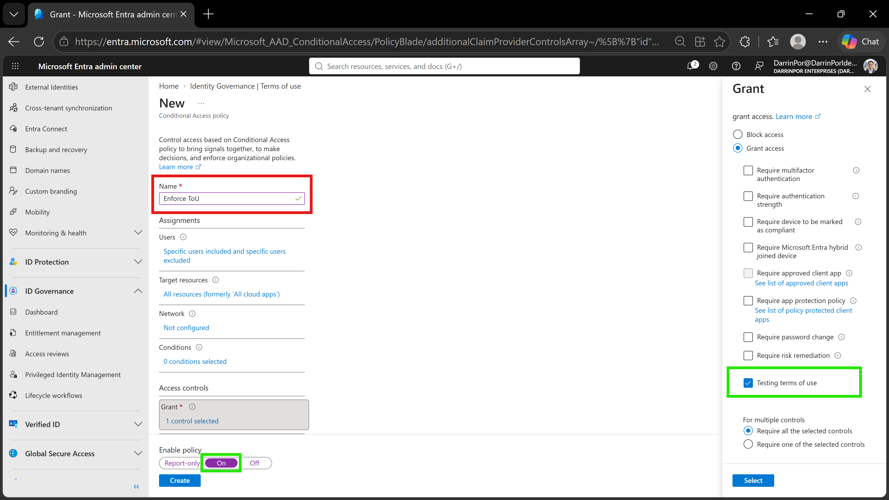
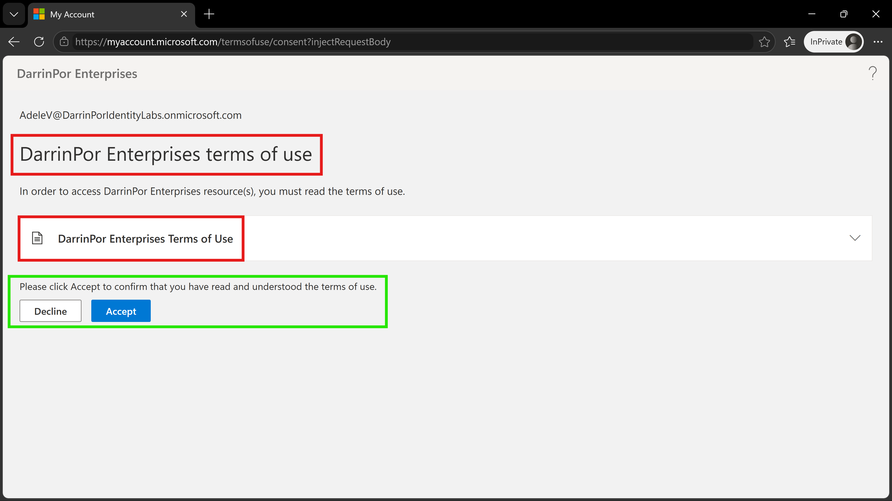
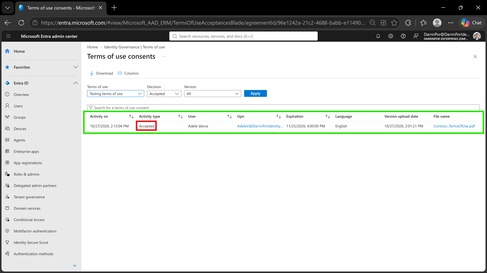

# 🛡️ Lab 23: Add Terms of Use and Acceptance Reporting

## 📋 1. Executive Summary & Objective
Microsoft Entra terms of use (ToU) policies provide a structured mechanism for organizations to present legal notices, compliance disclaimers, and organizational agreements to end users before granting access to cloud resources. By tying terms of use directly to **Conditional Access policies**, administrators can enforce mandatory user acknowledgment as a prerequisite for application and portal access.

The objective of this lab is to create and upload a customized terms of use document, configure a targeted Conditional Access policy to enforce acceptance, simulate user sign-in workflows, and verify compliance through Entra ID governance acceptance reporting.

In this scenario, legal attestation controls were executed and validated within the custom tenant:
1. **Terms of Use Provisioning:** Uploaded a standardized PDF agreement and configured expansion requirements.
2. **Conditional Access Integration:** Created a custom policy (*Enforce ToU*) leveraging grant controls to mandate acceptance for targeted users.
3. **User Experience Simulation:** Authenticated as a test user (*Adele Vance*) to review and accept the compliance document.
4. **Audit Logging & Reporting:** Tracked real-time consent events and audit logs via the Entra admin center.

---

## 🏗️ 2. Architecture & Control Design

```text
+-------------------------------------------------------------------------------------------------+
|                                  TENANT GOVERNANCE BOUNDARY                                     |
|                                                                                                 |
|    Directory Tenant: DarrinPor Enterprises (DarrinPorIdentityLabs.onmicrosoft.com)              |
|    Required Administrative Role: Global Administrator                                           |
+-----------------------------------+-----------------------------------------------------+-------+
                                    |
                                    v
+-------------------------------------------------------------------------------------------------+
|                            MICROSOFT ENTRA TERMS OF USE POLICY                                  |
|                                                                                                 |
|    - Internal Name: Testing terms of use                                                        |
|    - Display Name: DarrinPor Enterprises Terms of Use                                           |
|    - Source File: Contoso_TermsOfUse.pdf (Mandatory Expansion Enabled)                          |
+-----------------------------------+-----------------------------------------------------+-------+
                                    |
                                    v
+-------------------------------------------------------------------------------------------------+
|                           CONDITIONAL ACCESS POLICY: "Enforce ToU"                              |
|                                                                                                 |
|    - Assignments: Target Users & Groups -> Adele Vance                                          |
|    - Target Resources: All cloud apps (All resources)                                          |
|    - Grant Controls: Require terms of use -> Testing terms of use                               |
|    - Policy State: Enabled (On)                                                                 |
+-----------------------------------+-----------------------------------------------------+-------+
                                    |
        +---------------------------+---------------------------+
        |                                                       |
        v                                                       v
+----------------------------------+   +--------------------------------------------------+
|        USER ENFORCEMENT          |   |            AUDIT & REPORTING LOGS                |
|                                  |   |                                                  |
|  - User: Adele Vance             |   |  - Real-Time Consent Tracking                    |
|  - Action: Interactive Prompt    |   |  - UPN, Timestamp, & Status Verification         |
|  - Resolution: Mandated Consent  |   |  - Exportable Compliance Records                 |
+----------------------------------+   +--------------------------------------------------+

```

---

## ⚙️ 3. Step-by-Step Implementation

### Task 1: Create Terms of Use

1. Signed in to the **Microsoft Entra admin center** at `https://entra.microsoft.com` as a Global Administrator.


2. Expanded **ID Governance** in the left navigation menu and selected **Terms of use**.


3. Selected **+ New terms** on the top menu bar.


4. Configured internal and user-facing properties:
* **Name:** `Testing terms of use` (internal administrative identifier).


* **Terms of use document:** Uploaded `Contoso_TermsOfUse.pdf`.


* **Language:** `English`.


* **Display name:** `DarrinPor Enterprises Terms of Use` (rendered to users during sign-in).


* **Require users to expand the terms of use:** Set to **On** to mandate document expansion before consent.


5. Under *Conditional Access*, selected **Custom policy** and clicked **Create** to transition directly to policy creation.


### Task 2: Configure the Conditional Access Policy

1. In the newly generated Conditional Access blade, configured policy parameters:
* **Name:** `Enforce ToU`.


* **Assignments (Users):** Targeted `Adele Vance` under *Select users and groups*.


* **Target Resources:** Selected **All resources** (formerly *All cloud apps*).


* **Access Controls (Grant):** Selected **Grant access** and checked `Testing terms of use` as the required control.


* **Enable policy:** Toggled to **On**.


2. Selected **Create** to enforce the policy across the tenant.


### Task 3: Simulate User Sign-In & Acceptance

1. Opened an InPrivate browser session and authenticated as `AdeleV@DarrinPorIdentityLabs.onmicrosoft.com`.


2. Completed Multi-Factor Authentication (MFA) challenges when prompted.


3. Encountered the mandatory compliance prompt requiring the expansion and explicit acceptance of `DarrinPor Enterprises Terms of Use`.


4. Selected **Accept** to commit consent and proceed to cloud resources.


### Task 4: View Acceptance Reporting & Audit Logs

1. Returned to the Entra admin center and navigated to **ID Governance** > **Terms of use**.


2. Inspected the aggregated acceptance metrics and accessed the detailed **Terms of use consents** blade to verify individual transaction records.


---

## 📸 4. Verification & Audit Evidence

### 1. Terms of Use Creation & Properties
- **File:** `lab23-01-terms-of-use-creation.png`
- **Path:** `labs/Domain-4-Identity-Sync-And-Security/Lab-23-Add-terms-of-use-and-acceptance-reporting/screenshots/lab23-01-terms-of-use-creation.png`
- **Visual Focus:** Outline the internal **Name** (`Testing terms of use`) and custom **Display name** (`DarrinPor Enterprises Terms of Use`) in a **Red Box**; highlight the uploaded PDF file (`Contoso_TermsOfUse.pdf`) and the **Require users to expand the terms of use** toggle (*On*) in a **Green Box**.



### 2. Conditional Access User Assignment
- **File:** `lab23-02a-conditional-access-user-assignment.png`
- **Path:** `labs/Domain-4-Identity-Sync-And-Security/Lab-23-Add-terms-of-use-and-acceptance-reporting/screenshots/lab23-02a-conditional-access-user-assignment.png`
- **Visual Focus:** Outline the policy **Name** (`Enforce ToU`) in a **Red Box**; highlight the user assignment scoping specifically to **Adele Vance** in a **Green Box**.



### 3. Conditional Access Grant Controls & Policy State
- **File:** `lab23-02b-conditional-access-grant-controls.png`
- **Path:** `labs/Domain-4-Identity-Sync-And-Security/Lab-23-Add-terms-of-use-and-acceptance-reporting/screenshots/lab23-02b-conditional-access-grant-controls.png`
- **Visual Focus:** Outline the policy **Name** (`Enforce ToU`) in a **Red Box**; highlight the selected **Grant** control (`Testing terms of use`) and the **Enable policy** toggle set to **On** in **Green Boxes**.



### 4. User Terms of Use Presentation & Consent Prompt
- **File:** `lab23-03-user-terms-of-use-prompt.png`
- **Path:** `labs/Domain-4-Identity-Sync-And-Security/Lab-23-Add-terms-of-use-and-acceptance-reporting/screenshots/lab23-03-user-terms-of-use-prompt.png`
- **Visual Focus:** Outline the organization title and expandable document link (`DarrinPor Enterprises Terms of Use`) in a **Red Box**; highlight the mandatory user decision buttons (**Accept** / **Decline**) in a **Green Box**.



### 5. Terms of Use Acceptance Reporting & Consent Audit
- **File:** `lab23-04-acceptance-reporting.png`
- **Path:** `labs/Domain-4-Identity-Sync-And-Security/Lab-23-Add-terms-of-use-and-acceptance-reporting/screenshots/lab23-04-acceptance-reporting.png`
- **Visual Focus:** Outline the consent filter criteria in a **Red Box**; highlight the detailed audit record for **Adele Vance** showing exact timestamps, UPN, expiration, and **Accepted** status in a **Green Box**.



---

## 🛡️ 5. Zero Trust & Security Analysis

| Security Control | Threat Mitigation & Risk Assessment |
| --- | --- |
| **Mandatory Legal Attestation** | Prevents users from claiming ignorance of organizational policies by legally binding access to explicit document consent.

 
| **Conditional Access Integration** | Ensures terms cannot be bypassed; unaccepted policies automatically block token issuance and resource access.

 
| **Document Expansion Enforcement** | Eliminates 'blind clicking' by forcing users to expand and scroll through terms prior to enabling the acceptance button.

 
| **Tamper-Resistant Audit Logging** | Maintains immutable logs of user UPNs, exact timestamps, and PDF version hashes to satisfy regulatory audit requirements.

 

---

## 🧹 6. Rollback & Cleanup

To maintain tenant hygiene and preserve audit trails:

1. **Policy State Management:** The `Enforce ToU` policy and `Testing terms of use` object are retained in the tenant to support ongoing identity governance validation labs.
2. **Audit Verification:** Consent records remain accessible for inspection under **ID Governance** > **Terms of use** for the lifecycle of the policy.
