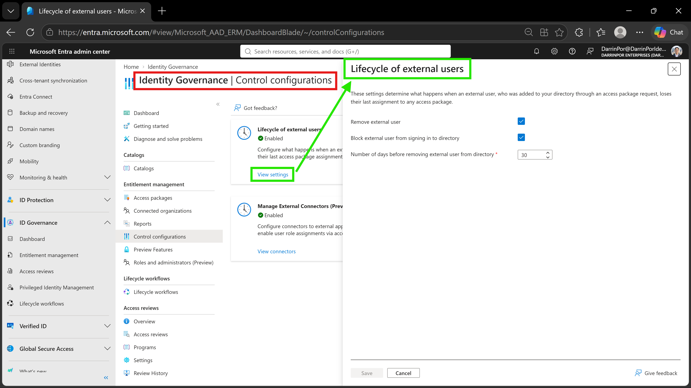
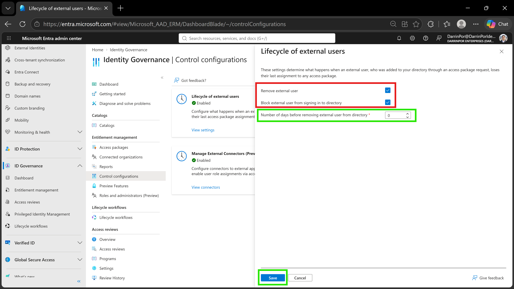

# 🛡️ Lab 24: Manage the Lifecycle of External Users in Microsoft Entra Identity Governance Settings

## 📋 1. Executive Summary & Objective

Microsoft Entra entitlement management provides automated lifecycle controls for external users (guests) invited into a tenant through approved access package requests. When an external user relinquishes all access package assignments or their last assignment expires, security risks emerge if stale accounts persist within the directory.

The objective of this lab is to configure **Entitlement Management Control Configurations** to automate the offboarding and cleanup of external users, mitigating tenant sprawl and enforcing Zero Trust least-privilege principles.

In this scenario, lifecycle governance policies were established and verified within the custom tenant:

1. **Control Navigation:** Located the Entitlement Management control configurations blade within the Entra admin center.


2. **External User Scoping:** Reviewed default behaviors regarding external user sign-in blocking and directory retention thresholds.


3. **Automated Cleanup Configuration:** Configured policies to immediately block sign-ins and remove external guest user accounts upon the expiration of their final access package assignment.


---

## 🏗️ 2. Architecture & Control Design

```text
+-------------------------------------------------------------------------------------------------+
|                                  TENANT GOVERNANCE BOUNDARY                                     |
|                                                                                                 |
|    Directory Tenant: DarrinPor Enterprises (DarrinPorIdentityLabs.onmicrosoft.com)              |
|    Required Administrative Role: Global Administrator                                           |
+-----------------------------------+-----------------------------------------------------+-------+
                                    |
                                    v
+-------------------------------------------------------------------------------------------------+
|                         ENTITLEMENT MANAGEMENT CONTROL CONFIGURATIONS                           |
|                                                                                                 |
|    - Path: ID Governance > Entitlement management > Control configurations                      |
|    - Target Section: Lifecycle of external users                                                |
+-----------------------------------+-----------------------------------------------------+-------+
                                    |
        +---------------------------+---------------------------+
        |                                                       |
        v                                                       v
+----------------------------------+   +--------------------------------------------------+
|      SIGN-IN RESTRICTION         |   |             AUTOMATED DIRECTORY PURGE            |
|                                  |   |                                                  |
|  - Action: Block external user   |   |  - Action: Remove external user                  |
|    from signing in to directory  |   |  - Retention Threshold: 0 Days                   |
|    (Enabled)                     |   |    (Immediate Purge)                             |
+----------------------------------+   +--------------------------------------------------+

```

---

## ⚙️ 3. Step-by-Step Implementation

### Task 1: Access Entitlement Management Control Configurations

1. Signed in to the **Microsoft Entra admin center** at `[https://entra.microsoft.com](https://entra.microsoft.com)` as a Global Administrator.


2. Expanded **ID Governance** in the left navigation menu and selected **Entitlement management**.


3. Under *Entitlement management*, selected **Control configurations**.


4. Located the **Lifecycle of external users** section and selected **View settings** to open the configuration pane.


### Task 2: Configure External User Lifecycle Policies

1. Reviewed the default settings governing external users who lose their final access package assignment.


2. Enabled **Block external user from signing in to directory** to instantly revoke access capabilities upon assignment expiration.


3. Enabled **Remove external user** to automate directory cleanup.


4. Set the **Number of days before removing external user from directory** field to `0` to enforce immediate account purging upon assignment termination.


5. Selected **Save** to commit the configuration changes.


---

## 📸 4. Verification & Audit Evidence

### 1. Control Configurations & Lifecycle Overview
- **File:** `lab24-01-control-configurations-landing.png`
- **Path:** `labs/Domain-4-Identity-Sync-And-Security/Lab-24-Manage-the-lifecycle-of-external-users-in-Microsoft-Entra-identities-governance-settings/screenshots/lab24-01-control-configurations-landing.png`
- **Visual Focus:** Outline the **Identity Governance | Control configurations** header in a **Red Box**; highlight the **Lifecycle of external users** overview card and **View settings** action link in a **Green Box**.



### 2. External User Lifecycle Configuration Settings
- **File:** `lab24-02-lifecycle-external-users-settings.png`
- **Path:** `labs/Domain-4-Identity-Sync-And-Security/Lab-24-Manage-the-lifecycle-of-external-users-in-Microsoft-Entra-identities-governance-settings/screenshots/lab24-02-lifecycle-external-users-settings.png`
- **Visual Focus:** Outline the active **Remove external user** and **Block external user from signing in to directory** check-boxes in a **Red Box**; highlight the **0** day retention threshold and active **Save** button in a **Green Box**.



---

## 🛡️ 5. Zero Trust & Security Analysis

| Security Control | Threat Mitigation & Risk Assessment |
| --- | --- |
| **Automated Offboarding** | Eliminates administrative oversight gaps by ensuring external accounts are automatically decommissioned when business justification ends. |
| **Immediate Sign-In Revocation** | Prevents dangling credentials and unauthorized lateral movement by instantly blocking sign-in rights upon resource detachment. |
| **Stale Guest Mitigation** | Reduces the tenant attack surface by purging inactive guest identities rather than leaving dormant accounts exposed. |
| **Least-Privilege Enforcement** | Ensures external identities maintain access only for the explicit duration required by active access packages.

 

---

## 🧹 6. Rollback & Cleanup

To maintain tenant hygiene and preserve governance configurations:

1. **Policy Persistence:** The automated lifecycle configuration remains active within the tenant to support ongoing identity governance validation labs.
2. **Exclusion Scope Note:** Entitlement management only purges accounts invited explicitly through entitlement management workflows; pre-existing guest accounts or manually provisioned accounts require separate lifecycle handling.

Would you like to proceed with preparing and documenting **Lab 25**, or is there a specific review step you would like to run on Domain 4 before moving forward?
