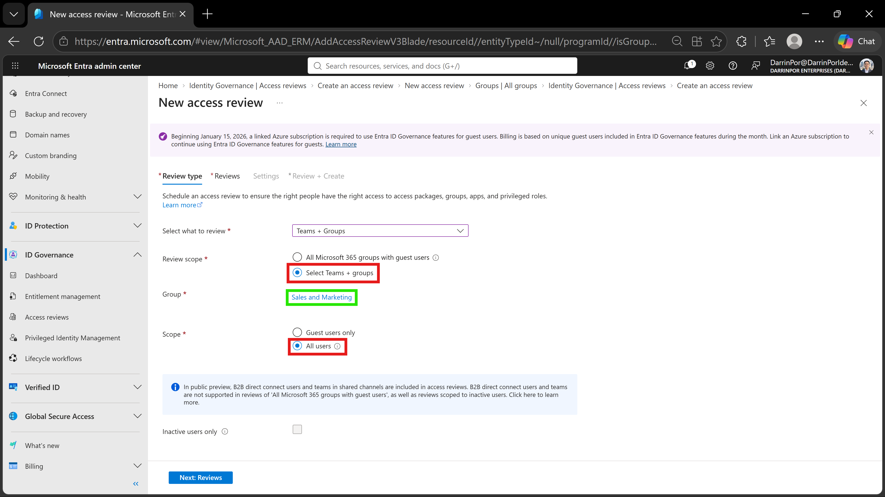
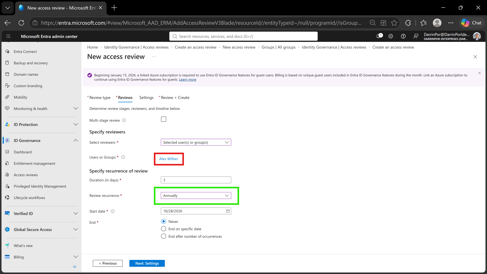
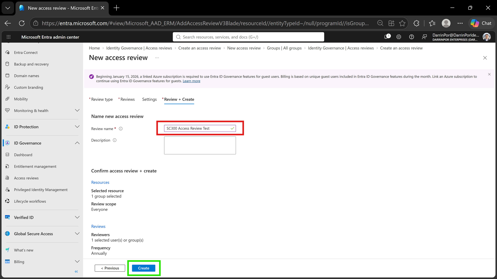

# 🛡️ Lab 25: Creating Access Reviews for Internal and External Users

## 📋 1. Executive Summary & Objective
Microsoft Entra access reviews enable organizations to efficiently manage group memberships, access package assignments, and application access. By periodically auditing user access rights, administrators ensure that users maintain only the permissions necessary for their roles, directly supporting Zero Trust least-privilege principles.

The objective of this lab is to create and configure an internal access review targeting a specific group (`Sales and Marketing`), assign a designated reviewer (`Alex Wilber`), and establish an annual review schedule. 

*Note: To fulfill the prerequisites for this validation lab, the `Sales and Marketing` group was created within the tenant, and `Alex Wilber` was manually added as a group member.*

In this scenario, identity governance controls were executed and validated within the custom tenant:
1. **Prerequisite Provisioning:** Manually established the target group and membership.
2. **Access Review Wizard:** Configured resource review scoping to target `Teams + groups` and `All users`.
3. **Reviewer & Schedule Assignment:** Delegated review responsibilities to `Alex Wilber` on an annual recurrence cycle.
4. **Review Finalization:** Named and committed the access review (`SC300 Access Review Test`).

---

## 🏗️ 2. Architecture & Control Design

```text
+-------------------------------------------------------------------------------------------------+
|                                  TENANT GOVERNANCE BOUNDARY                                     |
|                                                                                                 |
|    Directory Tenant: DarrinPor Enterprises (DarrinPorIdentityLabs.onmicrosoft.com)              |
|    Required Administrative Role: Global Administrator                                           |
+-----------------------------------+-----------------------------------------------------+-------+
                                    |
                                    v
+-------------------------------------------------------------------------------------------------+
|                           MICROSOFT ENTRA ACCESS REVIEW CONFIGURATION                           |
|                                                                                                 |
|    - Review Name: SC300 Access Review Test                                                      |
|    - Target Scope: Teams + Groups (Sales and Marketing Group)                                   |
|    - Review Scope: All users                                                                    |
+-----------------------------------+-----------------------------------------------------+-------+
                                    |
        +---------------------------+---------------------------+
        |                                                       |
        v                                                       v
+----------------------------------+   +--------------------------------------------------+
|        REVIEWER DELEGATION       |   |               SCHEDULE & RECURRENCE              |
|                                  |   |                                                  |
|  - Reviewer Type: Selected Users |   |  - Duration: Default (3 Days)                    |
|  - Reviewer Identity: Alex Wilber|   |  - Recurrence: Annually                          |
+----------------------------------+   +--------------------------------------------------+
```

---

## ⚙️ 3. Step-by-Step Implementation

### Task 1: Prerequisite Group & Membership Setup

1. Created the **Sales and Marketing** group manually within the Microsoft Entra admin center.
2. Added user **Alex Wilber** as a member of the group to establish the target baseline for access review evaluation.

### Task 2: Create a New Access Review

1. Signed in to the **Microsoft Entra admin center** at `https://entra.microsoft.com` as a Global Administrator.


2. Expanded **ID Governance** in the left navigation menu and selected **Access reviews**.


3. Selected **+ New access review** on the top menu bar.


4. On the *Create an access review* page, under *Choose an Access Review template*, selected **Resource review** and clicked **Select**.


5. On the *New access review* page, opened the **Select review** dropdown and chose **Teams + Groups**.


6. Under *Review scope*, selected **Select Teams - groups**.


7. Clicked **+ Select group(s)**, chose the **Sales and Marketing** group from the directory list, and selected **Select**.


8. Under *Scope*, selected **All users**.


9. Selected **Next: Reviews** to proceed.


### Task 3: Configure Reviewers and Recurrence

1. On the *Reviews* tab, opened the **Select reviewers** dropdown and selected **Selected user(s) or group(s)**.


2. Clicked **+ Select reviewers**, searched for **Alex Wilber**, selected the user, and clicked **Select**.


3. Under *Specify recurrence of review*, kept the default duration and set **Review recurrence** to **Annually**.


4. Selected **Next: Settings** and reviewed the default configuration options.


5. Selected **Next: Review + Create**.


### Task 4: Name and Finalize the Access Review

1. On the *Review + Create* tab, entered `SC300 Access Review Test` under **Review name**.


2. Selected **Create** to deploy the access review across the tenant.


---

## 📸 4. Verification & Audit Evidence

### 1. Access Review Scope & Target Selection
- **File:** `lab25-01-access-review-scope.png`
- **Path:** `labs/Domain-4-Identity-Sync-And-Security/Lab-25-Creating-Access-Reviews-for-Internal-and-External-Users/screenshots/lab25-01-access-review-scope.png`
- **Visual Focus:** Outline the **Select Teams - groups** option and **All users** scope in a **Red Box**; highlight the targeted **Sales and Marketing** group in a **Green Box**.



### 2. Reviewer Assignment & Recurrence Configuration
- **File:** `lab25-02-access-review-settings.png`
- **Path:** `labs/Domain-4-Identity-Sync-And-Security/Lab-25-Creating-Access-Reviews-for-Internal-and-External-Users/screenshots/lab25-02-access-review-settings.png`
- **Visual Focus:** Outline the designated reviewer **Alex Wilber** in a **Red Box**; highlight the **Review recurrence** set to **Annually** in a **Green Box**.



### 3. Review Name & Final Creation Summary
- **File:** `lab25-03-access-review-creation.png`
- **Path:** `labs/Domain-4-Identity-Sync-And-Security/Lab-25-Creating-Access-Reviews-for-Internal-and-External-Users/screenshots/lab25-03-access-review-creation.png`
- **Visual Focus:** Outline the populated **Review name** field (`SC300 Access Review Test`) in a **Red Box**; highlight the active **Create** button in a **Green Box**.



---

## 🛡️ 5. Zero Trust & Security Analysis

| Security Control | Threat Mitigation & Risk Assessment |
| --- | --- |
| **Privileged Access Attestation** | Prevents privilege creep by forcing regular supervisory review of group memberships and sensitive resource access.

| **Delegated Governance** | Offloads operational review overhead from Global Administrators to designated business owners or specific users like `Alex Wilber`. 

| **Recurring Compliance Schedules** | Eliminates manual tracking gaps by enforcing automated annual reviews of active directory memberships.

| **Least-Privilege Enforcement** | Ensures dormant or unnecessary group assignments are systematically identified and purged.

---

## 🧹 6. Rollback & Cleanup

To maintain tenant hygiene:

1. **Review Retention:** The `SC300 Access Review Test` object is retained within the Entra identity governance console to support ongoing auditing labs.


2. **Group Lifecycle:** The `Sales and Marketing` group and user assignments remain intact for upcoming identity validation exercises.
