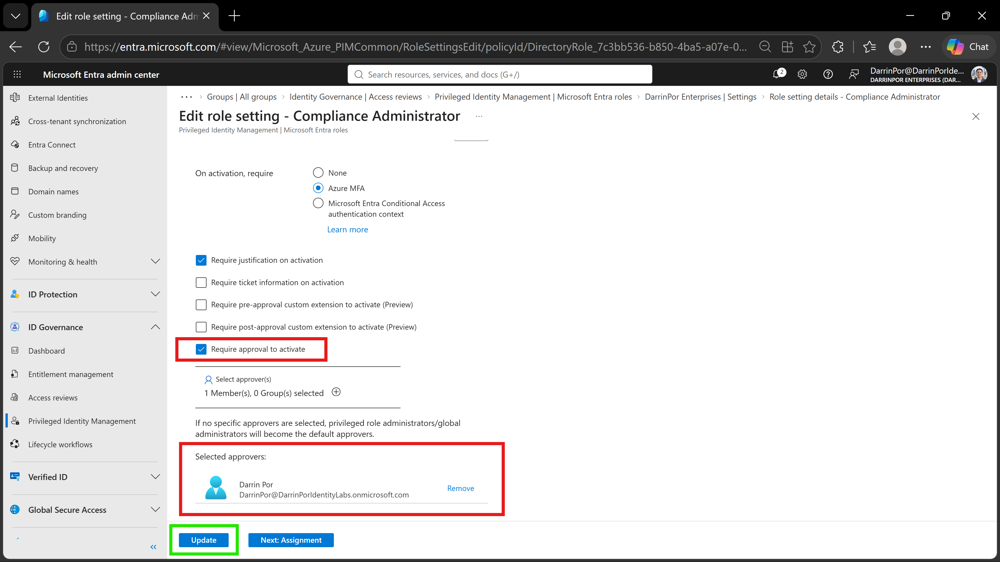
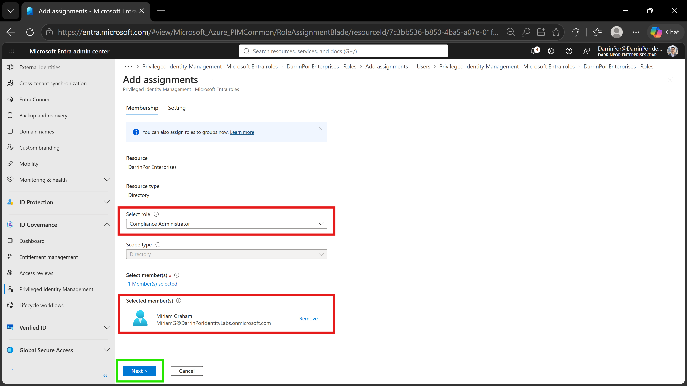
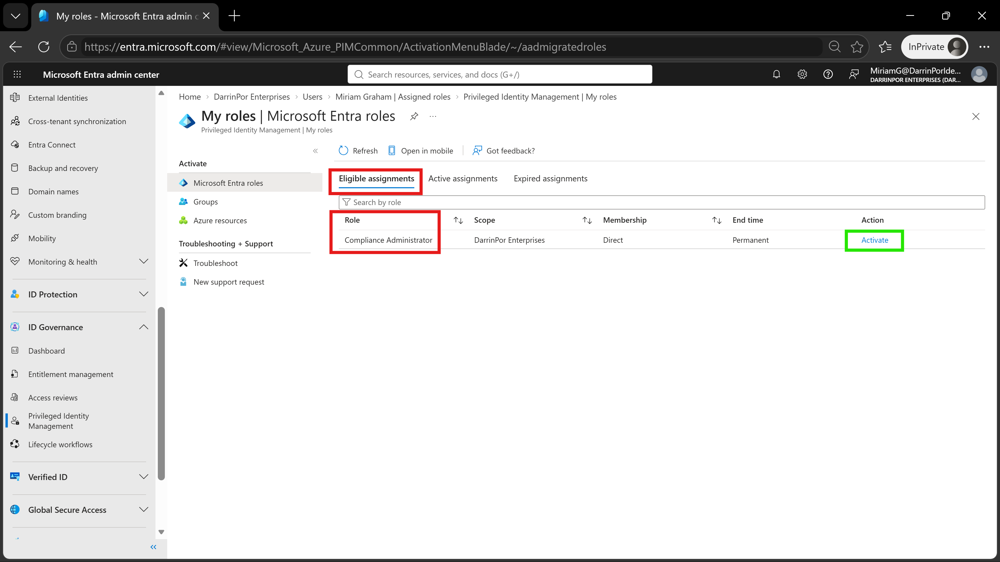
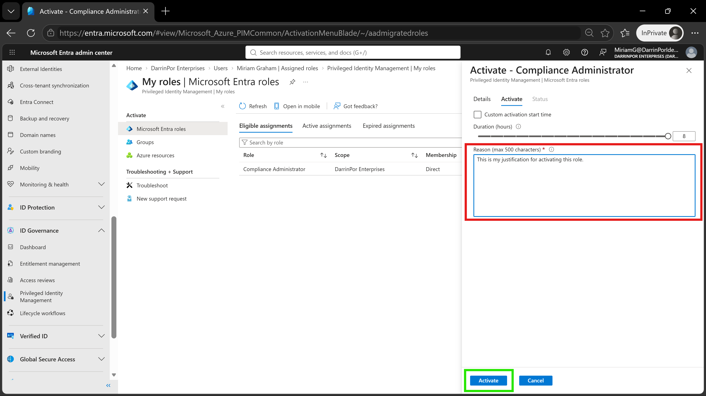

# 🛡️ Lab 26: Configure Privileged Identity Management for Microsoft Entra Roles

## 📋 1. Executive Summary & Objective
Microsoft Entra Privileged Identity Management (PIM) provides time-bound, approval-based role activation to minimize standing administrative access risks across tenant resources. Permanent administrator assignments increase attack surface exposure, leaving organizations vulnerable to credential compromise and unauthorized privilege escalation.

The objective of this lab is to configure PIM policies for the `Compliance Administrator` role by enforcing mandatory approval requirements, assigning eligible role status to a user (`Miriam Graham`), and validating the Just-In-Time (JIT) role activation workflow.

*Note: To fulfill the prerequisites for this validation lab, user `Miriam Graham` was manually created within the directory prior to executing PIM assignment policies.*

In this scenario, identity governance controls were configured and validated within the custom tenant:
1. **Prerequisite Provisioning:** Created target user `Miriam Graham` within the tenant directory.
2. **PIM Policy Customization:** Enforced approval requirements and designated `Darrin Por` as the primary approver for activating the `Compliance Administrator` role.
3. **Eligible Role Assignment:** Assigned user `Miriam Graham` eligible membership for the `Compliance Administrator` role via PIM.
4. **JIT Activation Verification:** Authenticated as `Miriam Graham`, accessed the PIM portal, provided business justification, and successfully executed the role activation flow.

---

## 🏗️ 2. Architecture & Control Design

```text
+-------------------------------------------------------------------------------------------------+
|                                  TENANT GOVERNANCE BOUNDARY                                     |
|                                                                                                 |
|    Directory Tenant: DarrinPor Enterprises (DarrinPorIdentityLabs.onmicrosoft.com)              |
|    Required Administrative Role: Global Administrator / Privileged Role Administrator            |
+-----------------------------------+-----------------------------------------------------+-------+
                                    |
                                    v
+-------------------------------------------------------------------------------------------------+
|                       PRIVILEGED IDENTITY MANAGEMENT (PIM) ROLE POLICY                          |
|                                                                                                 |
|    - Target Role: Compliance Administrator                                                      |
|    - Activation Policy: Approval Required = True                                                |
|    - Designated Approver: Darrin Por                                                            |
+-----------------------------------+-----------------------------------------------------+-------+
                                    |
        +---------------------------+---------------------------+
        |                                                       |
        v                                                       v
+----------------------------------+   +--------------------------------------------------+
|      ELIGIBLE MEMBER ASSIGNMENT  |   |           JUST-IN-TIME (JIT) ACTIVATION          |
|                                  |   |                                                  |
|  - Target User: Miriam Graham    |   |  - Portal: PIM > My roles                        |
|  - Membership State: Eligible    |   |  - Requirement: Business Justification &         |
|  - Assignment Type: Direct       |   |    Session MFA Verification                      |
+----------------------------------+   +--------------------------------------------------+

```

---

## ⚙️ 3. Step-by-Step Implementation

### Task 1: Prerequisite User Creation

1. Signed in to the **Microsoft Entra admin center** as Global Administrator.


2. Navigated to **Entra ID** > **Users** > **All users** and created user **Miriam Graham** (`MiriamG@DarrinPorIdentityLabs.onmicrosoft.com`).


### Task 2: Configure PIM Role Settings

1. Expanded **ID Governance** in the left navigation menu and selected **Privileged Identity Management**.


2. Under PIM, selected **Microsoft Entra roles** > **Settings**.


3. Searched for and selected the **Compliance Administrator** role.


4. Selected **Edit** at the top of the role settings page.


5. Checked **Require approval to activate**.


6. Clicked **Select approvers**, searched for **Darrin Por**, selected the account, and saved the approver assignment.


7. Selected **Update** to commit the PIM role configuration changes.


### Task 3: Assign Eligible Role to User

1. Within PIM **Microsoft Entra roles**, selected **Roles** and clicked **+ Add assignments**.


2. Under **Select role**, chose **Compliance Administrator**.


3. Under **Select member(s)**, selected **Miriam Graham**.


4. Navigated to the **Settings** tab, confirmed assignment type was set to **Eligible**, and selected **Assign**.


### Task 4: Verify Role Activation Flow

1. Opened an **InPrivate** browser window and signed in to `https://entra.microsoft.com` as **Miriam Graham**.


2. Navigated to **Privileged Identity Management** > **My roles**.


3. Located **Compliance Administrator** under the **Eligible assignments** tab and clicked **Activate**.


4. In the activation flyout pane, entered business justification (`This is my justification for activating this role.`) inside the **Reason** text area.


5. Selected **Activate** to submit the request for approval.

---

## 📸 4. Verification & Audit Evidence

### 1. PIM Role Settings Approval Configuration
- **File:** `lab26-01-pim-role-settings-approval.png`
- **Path:** `labs/Domain-4-Identity-Sync-And-Security/Lab-26-Configure-Privileged-Identity-Management-for-Microsoft-Entra-roles/screenshots/lab26-01-pim-role-settings-approval.png`
- **Visual Focus:** Outline the checked **Require approval to activate** setting and assigned approver (`Darrin Por`) in a **Red Box**; highlight the **Update** button in a **Green Box**.



### 2. PIM Role Assignment to User
- **File:** `lab26-02-pim-role-assignment.png`
- **Path:** `labs/Domain-4-Identity-Sync-And-Security/Lab-26-Configure-Privileged-Identity-Management-for-Microsoft-Entra-roles/screenshots/lab26-02-pim-role-assignment.png`
- **Visual Focus:** Outline the target role (`Compliance Administrator`) and assigned user (`Miriam Graham`) in a **Red Box**; highlight the **Next >** button in a **Green Box**.



### 3. Eligible Assignment View in User's PIM Portal
- **File:** `lab26-03-pim-eligible-roles.png`
- **Path:** `labs/Domain-4-Identity-Sync-And-Security/Lab-26-Configure-Privileged-Identity-Management-for-Microsoft-Entra-roles/screenshots/lab26-03-pim-eligible-roles.png`
- **Visual Focus:** Outline the **Eligible assignments** tab and `Compliance Administrator` role in a **Red Box**; highlight the **Activate** action button in a **Green Box**.



### 4. Role Activation Pane & Justification
- **File:** `lab26-04-pim-role-activation.png`
- **Path:** `labs/Domain-4-Identity-Sync-And-Security/Lab-26-Configure-Privileged-Identity-Management-for-Microsoft-Entra-roles/screenshots/lab26-04-pim-role-activation.png`
- **Visual Focus:** Outline the populated **Reason** justification box in a **Red Box**; highlight the active **Activate** button in a **Green Box**.



---

## 🛡️ 5. Zero Trust & Security Analysis

| Security Control | Threat Mitigation & Risk Assessment |
| --- | --- |
| **Elimination of Standing Privileges** | Replaces permanent administrator rights with time-bound eligible roles, minimizing account takeover exposure.
| **Mandatory Approval Workflow** | Ensures high-privilege activations are vetted by authorized administrators (`Darrin Por`) before rights are granted.
| **Justification & Audit Logging** | Forces users to log specific business reasons for activation, creating clear compliance audit trails.
| **Least-Privilege Enforcement** | Restricts administrative rights strictly to active sessions, automatically revoking access upon expiration.

---

## 🧹 6. Rollback & Cleanup

To restore baseline tenant configuration:

1. **Assignment Removal:** Navigated to PIM **Microsoft Entra roles** > **Assignments**, located the `Compliance Administrator` assignment for `Miriam Graham`, and selected **Remove**.
2. **Policy Reset:** Reverted the `Compliance Administrator` role settings to restore standard tenant default configurations if needed.
