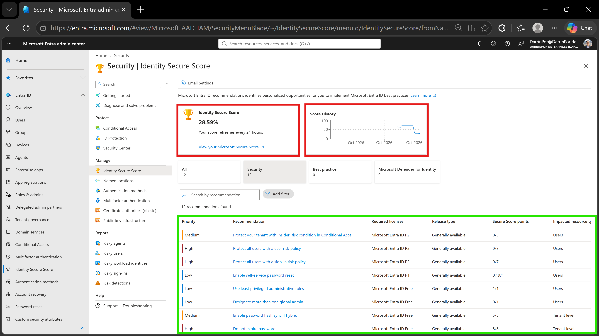
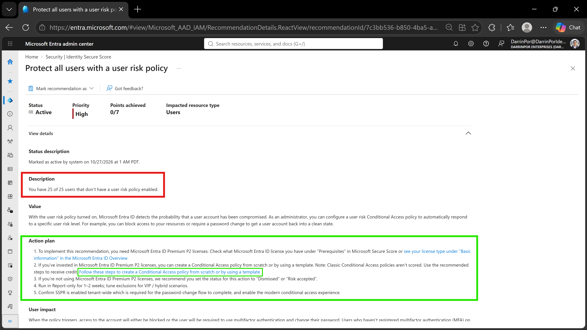
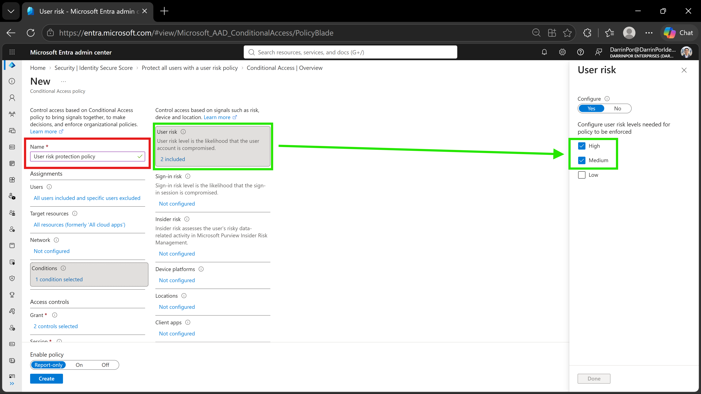
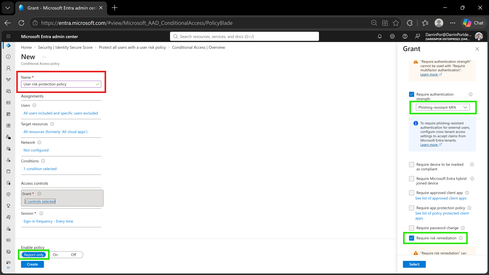

# 🛡️ Lab 28: Monitor and Managed Security Posture with Identity Secure Score

## 📋 1. Executive Summary & Objective

Microsoft Entra Identity Protection and Identity Secure Score provide continuous monitoring, automated detection, and actionable recommendations to harden an organization's identity security posture. Much like Microsoft Defender XDR, Identity Secure Score evaluates directory configurations against security benchmarks and assigns quantitative scores with associated impact metrics.

The objective of this lab is to review the Identity Secure Score dashboard, analyze identity-specific recommendations, and initiate an improvement action by drafting a user risk-based Conditional Access policy.

Note: While pre-packaged training documentation references a sample tenant size of 33 users, this custom validation tenant operates with 25 active user accounts, all of which were evaluated under the user risk policy recommendation.

In this scenario, identity posture controls were executed and validated within the custom tenant:

1. **Secure Score Baseline Review:** Inspected overall score history, metrics, and identity-specific recommendations.


2. **Improvement Action Analysis:** Evaluated the `Protect all users with a user risk policy` recommendation and analyzed unprotected user metrics.


3. **Risk-Based Policy Authoring:** Drafted a Conditional Access policy targeting High and Medium user risk levels.


4. **Grant Controls & Validation:** Enforced phishing-resistant MFA and risk remediation controls in **Report-only** mode.


---

## 🏗️ 2. Architecture & Control Design

```text
+-------------------------------------------------------------------------------------------------+
|                                  TENANT GOVERNANCE BOUNDARY                                     |
|                                                                                                 |
|    Directory Tenant: DarrinPor Enterprises (DarrinPorIdentityLabs.onmicrosoft.com)              |
|    Required Administrative Role: Global Administrator                                           |
+-----------------------------------+-----------------------------------------------------+-------+
                                    |
                                    v
+-------------------------------------------------------------------------------------------------+
|                          IDENTITY SECURE SCORE & RECOMMENDATION ENGINE                          |
|                                                                                                 |
|    - Evaluated Metric: Identity Secure Score Dashboard                                          |
|    - Target Recommendation: Protect all users with a user risk policy                           |
|    - Unprotected Scope: 25 User Accounts                                                        |
+-----------------------------------+-----------------------------------------------------+-------+
                                    |
                                    v
+-------------------------------------------------------------------------------------------------+
|                         CONDITIONAL ACCESS RISK CONTROL CONFIGURATION                           |
|                                                                                                 |
|    - Policy Name: User risk protection policy                                                   |
|    - Assignments: All users (excluding MOD Administrator)                                       |
|    - Conditions: User Risk = High and Medium                                                    |
|    - Grant Controls: Require risk remediation & Phishing-resistant MFA                          |
|    - Enforcement State: Report-only                                                             |
+-------------------------------------------------------------------------------------------------+

```

---

## ⚙️ 3. Step-by-Step Implementation

### Task 1: Review Identity Secure Score and Recommendations

1. Signed in to the **Microsoft Entra admin center** at `[https://entra.microsoft.com](https://entra.microsoft.com)` as Global Administrator.


2. Expanded the left navigation menu under **Entra ID** and selected **Identity Secure Score**.


3. Reviewed the overall Secure Score percentage, score history metrics, and active recommendations.


4. Inspected the identity-specific improvement actions listed in the recommendations table.


### Task 2: Execute an Improvement Action (User Risk Policy)

1. Selected the **Protect all users with a user risk policy** recommendation item.


2. Reviewed the impact details, noting the count of unprotected accounts across the tenant directory.


3. Navigated to **Conditional Access** from the left menu and selected **+ Create new policy**.


4. Configured the policy parameters:


* **Name:** `User risk protection policy`


* **Assignments:** Included **All users** and excluded the `MOD Administrator` account.


* **Target Resources:** Configured for **All resources** (formerly all cloud apps).


* **Conditions:** Set **User risk** to **Configure = Yes**, checking both **High** and **Medium** risk levels.


* **Access Controls:** Under Grant, selected **Require risk remediation** and checked **Phishing-resistant MFA**.


5. Set the **Enable policy** toggle to **Report-only** to validate behavior safely without impacting active user sign-ins.


6. Selected **Create** to deploy the policy.


---

## 📸 4. Verification & Audit Evidence

### 1. Identity Secure Score Dashboard & Recommendations
- **File:** `lab28-01-identity-secure-score-dashboard.png`
- **Path:** `labs/Domain-4-Identity-Sync-And-Security/Lab-28-Monitor-and-managed-security-posture-with-Identity-Secure-Score/screenshots/lab28-01-identity-secure-score-dashboard.png`
- **Visual Focus:** Outline the overall **Identity Secure Score** metric and score history in a **Red Box**; highlight the **Recommendations** table in a **Green Box**.



### 2. Improvement Action Details & User Impact
- **File:** `lab28-02-improvement-action-details.png`
- **Path:** `labs/Domain-4-Identity-Sync-And-Security/Lab-28-Monitor-and-managed-security-posture-with-Identity-Secure-Score/screenshots/lab28-02-improvement-action-details.png`
- **Visual Focus:** Outline the description showing unprotected user count (`25 of 25 users`) in a **Red Box**; highlight the **Action plan** guidance links in a **Green Box**.



### 3. User Risk Policy Conditions Configuration
- **File:** `lab28-03-user-risk-policy-conditions.png`
- **Path:** `labs/Domain-4-Identity-Sync-And-Security/Lab-28-Monitor-and-managed-security-posture-with-Identity-Secure-Score/screenshots/lab28-03-user-risk-policy-conditions.png`
- **Visual Focus:** Outline the policy **Name** (`User risk protection policy`) in a **Red Box**; highlight the **User risk** configuration panel with **High** and **Medium** risk levels selected in **Green Boxes**.



### 4. Grant Controls & Report-Only State
- **File:** `lab28-04-user-risk-policy-grant-controls.png`
- **Path:** `labs/Domain-4-Identity-Sync-And-Security/Lab-28-Monitor-and-managed-security-posture-with-Identity-Secure-Score/screenshots/lab28-04-user-risk-policy-grant-controls.png`
- **Visual Focus:** Outline the policy **Name** in a **Red Box**; highlight the selected grant controls (**Phishing-resistant MFA**, **Require risk remediation**) and the **Report-only** toggle in **Green Boxes**.



---

## 🛡️ 5. Zero Trust & Security Analysis

| Security Control | Threat Mitigation & Risk Assessment |
| --- | --- |
| **Quantitative Posture Tracking** | Continuously evaluates tenant configuration gaps using Identity Secure Score metrics to prioritize security remediation.


| **Risk-Based Signal Integration** | Automatically responds to compromised user credentials by intercepting sessions flagged with high or medium risk.


| **Phishing-Resistant Enforcement** | Requires advanced authentication strength during risk remediation to prevent credential replay and secondary takeovers.


| **Safe Deployment Validation** | Utilizes **Report-only** mode to measure policy impact and review log telemetry before enforcing live blocks.

---

## 🧹 6. Rollback & Cleanup

To maintain tenant hygiene:

1. **Policy State Retention:** The `User risk protection policy` is retained in **Report-only** mode within the Conditional Access console to support ongoing security posture auditing.


2. **Secure Score Tracking:** Monitored the Secure Score console to verify posture improvement trends over the 24-hour telemetry calculation window.
